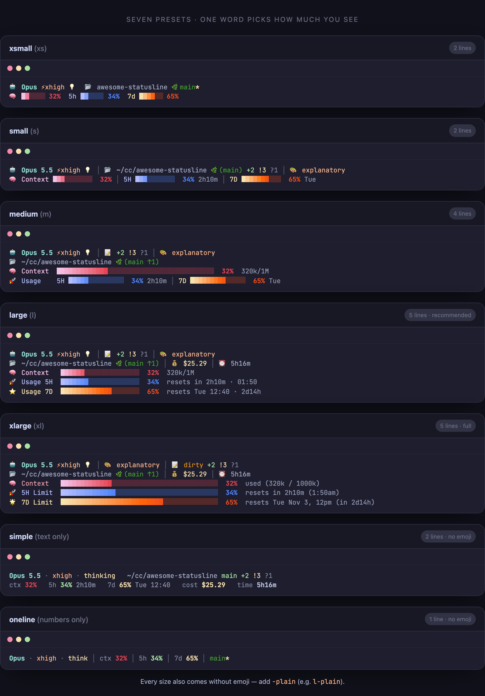
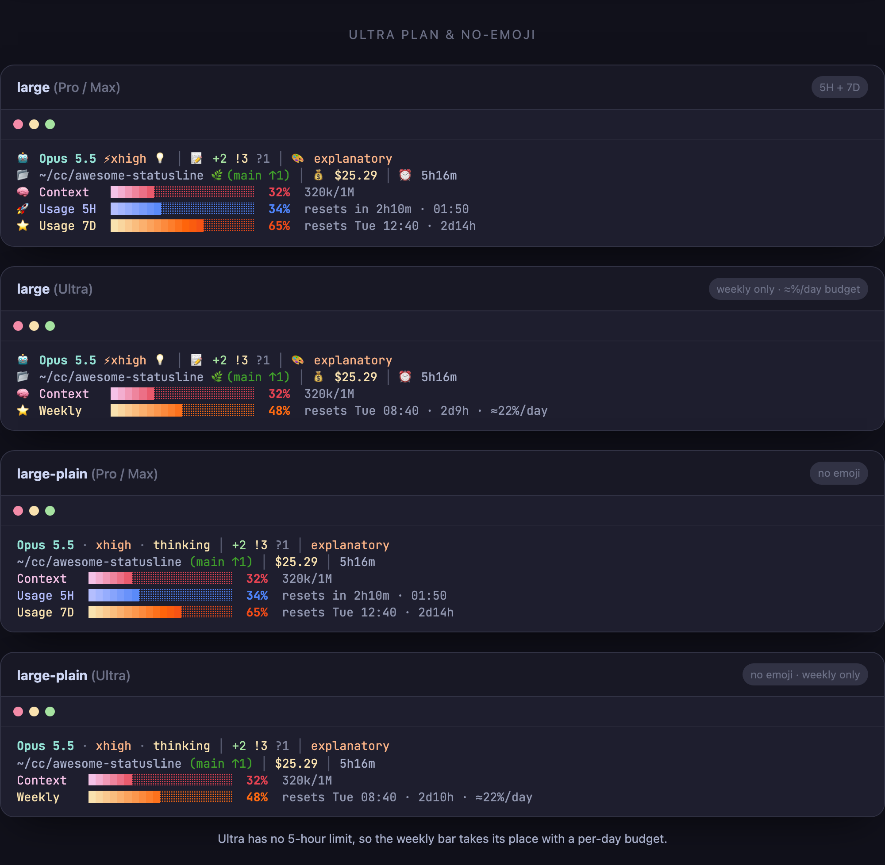

<div align="center">


# ⚡ Awesome Statusline

**[Claude Code](https://claude.com/claude-code)를 위한 아름다운 상태줄 — 컨텍스트, 사용량 한도, 비용, 추론 강도(`⚡effort`)를 한눈에. macOS·Linux·Windows 한 줄 설치.**

[🇺🇸 English](README.md) · [빠른 설치](#-빠른-설치) · [프리셋](#-프리셋) · [표시 항목](#-무엇을-보여주나요) · [FAQ](#-faq)


<br/><br/>



<sub>▶ <a href="https://awesomezun.github.io/claude-statusline/">인터랙티브 라이브 데모</a></sub>

</div>

---

## 🆕 업데이트 소식

Claude Code 최신 기능에 맞춰 계속 업데이트됩니다 — 최근 내역:

| 날짜 | 업데이트 |
|------|----------|
| **2026-10-31** | **Ultra 요금제 지원 + 디자인 개편** — Ultra는 5시간 한도가 없어서 주간 막대와 하루 예산을 보여 줍니다(예전에는 `0% (loading..)`에서 멈췄습니다) · 모든 크기 디자인 정돈: 열 정렬, 퍼센트 칸 폭 고정, 리셋을 *2h10m 후 · 01:50*처럼 표시, 빈 정보 숨김 · 모든 크기에 **이모지 없음 옵션**(`-plain`) · 텍스트형 새 프리셋 **`simple`**, **`oneline`** · 모든 프리셋을 렌더러 하나로 통합해 갱신 속도 약 4배 향상 |
| **2026-10-17** | **한국어 등 비영어 Windows 환경** — 세션 이름에 한글 같은 비ASCII 문자가 있으면 상태줄이 `Unknown` / 0%로 표시되던 문제 수정 · 컨텍스트 창 크기가 잘못 보고될 때의 보정 추가 |
| **2026-06-03** | **설치 크기 선택** — Claude Code로 설치할 때 5가지 프리셋 중 원하는 크기를 항상 물어봄(`large` 추천) |
| **2026-06-02** | **Windows 네이티브 렌더러** — PowerShell 상태줄 경로, Windows에서 Git Bash나 `jq` 불필요 |
| **2026-05-31** | **Opus 4.8** 지원 · 추론 강도 **effort**(`high`/`xhigh`/`max`) + **thinking** 표시 · 크로스플랫폼 한 줄 설치 · 5단계 프리셋(`xs`–`xl`) · JetBrains Mono |
| **2026-04-01** | **1M 토큰 컨텍스트 창** 지원(Opus) · 첫 대화 전에도 사용량 바 표시 |
| **2026-01-19** | 멀티 모드 디스플레이 시스템 · 플러그인 마켓플레이스 |
| **2026-01-18** | Catppuccin 그래디언트 바 · 실시간 **5시간 / 7일** 사용량 한도 모니터링 |

---

## 주요 특징

- ⚡ **추론 강도 & thinking** — `/effort`(`high`/`xhigh`/`max`)와 확장 사고를 Claude Code 공식 상태줄 JSON에서 실시간 표시 (effort 미지원 모델에선 자동 숨김).
- 📊 **모든 요금제의 한도** — Pro / Max는 5시간·주간 막대와 리셋까지 남은 시간을, **Ultra**(주간 한도만 있음)는 주간 막대와 하루 예산을 보여 줍니다.
- 🔤 **이모지 있음 / 없음** — 모든 크기를 이모지 없이도 쓸 수 있고(`-plain`), 텍스트형 `simple`·`oneline` 프리셋도 있습니다.
- 🖥️ **Node·Nerd Font 불필요** — macOS/Linux는 Bash, Windows는 네이티브 PowerShell을 씁니다. macOS/Linux에서는 필요하면 `jq`를 자동 설치합니다.
- 📐 **7가지 프리셋** — `xs`~`xl`, `simple`, `oneline` 중 한 단어로 정보량을 고릅니다.

> 훌륭한 Claude Code 상태줄이 이미 여럿 있습니다. 이 프로젝트는 그중 추론 강도(effort)/thinking 가시성과 무설치 크로스플랫폼 설치에 집중합니다.

---

## 🚀 빠른 설치

Node가 필요 없습니다. Windows에서는 `jq`, Git, Git Bash도 필요 없습니다 — 설치 스크립트가 PowerShell 경로를 사용합니다.

**macOS / Linux**
```bash
curl -fsSL https://raw.githubusercontent.com/awesomezun/claude-statusline/main/install.sh | bash
```

**Windows (PowerShell)**
```powershell
irm https://raw.githubusercontent.com/awesomezun/claude-statusline/main/install.ps1 | iex
```

보안 프로그램이 `irm | iex`를 막으면, 먼저 파일로 내려받아 확인한 뒤 실행하세요:
```powershell
Invoke-WebRequest -Uri https://raw.githubusercontent.com/awesomezun/claude-statusline/main/install.ps1 -OutFile .\install.ps1
notepad .\install.ps1
powershell -NoProfile -ExecutionPolicy Bypass -File .\install.ps1
```

원하는 프리셋을 뒤에 붙여 바로 지정할 수도 있습니다:
```bash
curl -fsSL https://raw.githubusercontent.com/awesomezun/claude-statusline/main/install.sh | bash -s -- l-plain
```

**또는 클론 후 실행**:
```bash
git clone https://github.com/awesomezun/claude-statusline.git && cd claude-statusline
./install.sh            # macOS / Linux
./install.ps1           # Windows PowerShell
```

프리셋은 약어·풀네임 둘 다 됩니다: `xs`/`xsmall`, `s`/`small`, `m`/`medium`, `l`/`large`, `xl`/`xlarge`(이모지 없이 쓰려면 `l-plain`처럼 `-plain`을 붙입니다), 그리고 `simple` / `oneline`.
그다음 Claude Code를 재시작하면 끝입니다.

---

## 📐 프리셋

한 단어로 정보량을 고릅니다. 작은 것 → 큰 것:

| 프리셋 | 줄 | 한눈에 |
|--------|:--:|--------|
| `oneline` | 1 | 숫자만, 이모지 없음 — 모델 · effort · 컨텍스트 · 한도 · 브랜치 |
| `xsmall` (`xs`) | 2 | 모델 · effort · thinking · 폴더 · 브랜치 · 작은 막대 3개 |
| `small` (`s`) | 2 | + 라벨, 퍼센트, 리셋까지 남은 시간, 출력 스타일 |
| `simple` | 2 | 텍스트만, 막대·이모지 없음 — 한도 값은 페이스에 따라 색 표시 |
| `medium` (`m`) | 4 | 넓은 컨텍스트 막대, git 상태 |
| `large` (`l`) | 5 | + 비용, 세션 시간, 리셋 시각 — **추천** |
| `xlarge` (`xl`) | 5 | 전부: 40칸 막대, 리셋 날짜까지 |

**이모지가 싫으신가요?** 어떤 크기든 `-plain`을 붙이면 됩니다(`xs-plain` … `xl-plain`). 배치는 같고 아이콘 대신 글자 라벨을 써서, tmux·SSH·Windows 콘솔에서 가장 안정적으로 보입니다.

### Ultra 요금제 & 이모지 없음

Ultra 요금제는 5시간 한도가 없어서, 그 자리에 주간 막대와 하루 예산을 보여 줍니다(`≈22%/day` = 하루에 이만큼까지 써도 주간 한도 안에 들어온다는 뜻입니다). Pro / Max는 5H + 7D 막대를 그대로 보여 줍니다. 따로 설정할 것은 없습니다. Claude Code가 알려 주는 한도에 맞춰 화면이 자동으로 바뀝니다.

<div align="center">

</div>

> 🔤 *내* 폰트에선 어떻게 보일까요? **[12개 폰트 쇼케이스 →](demo.md)** — 크로스플랫폼 모노 폰트 10개와 Menlo, MesloLGS를 담았습니다.

<details>
<summary>📋 텍스트 미리보기 (복사·붙여넣기용)</summary>
<br/>

터미널에서는 색이 함께 표시됩니다:

```text
oneline ─ 1줄, 숫자만
Opus · xhigh · think │ ctx 32% │ 5h 34% │ 7d 65% │ main*

xsmall ─ 2줄
🤖 Opus ⚡xhigh 💡  📂 awesome-statusline 🌿main*
🧠 ██░░░░ 32%  5h ██░░░░ 34%  7d ████░░ 65%

small ─ 2줄
🤖 Opus 5.5 ⚡xhigh 💡 │ 📂 ~/cc/awesome-statusline 🌿(main) +2 !3 ?1 │ 🎨 explanatory
🧠 Context ███░░░░░░░  32% │ 5H ███░░░░░░░  34% 2h10m │ 7D ███████░░░  65% Tue

simple ─ 2줄, 텍스트만
Opus 5.5 · xhigh · thinking   ~/cc/awesome-statusline main +2 !3 ?1
ctx 32%   5h 34% 2h10m   7d 65% Tue 12:40   cost $25.29   time 5h16m

medium ─ 4줄
🤖 Opus 5.5 ⚡xhigh 💡 │ 📝 +2 !3 ?1 │ 🎨 explanatory
📂 ~/cc/awesome-statusline 🌿(main ↑1)
🧠 Context  █████████████░░░░░░░░░░░░░░░░░░░░░░░░░░░  32%  320k/1M
🚀 Usage    5H █████░░░░░░░░░  34% 2h10m │ 7D █████████░░░░░  65% Tue

large ─ 5줄
🤖 Opus 5.5 ⚡xhigh 💡 │ 📝 +2 !3 ?1 │ 🎨 explanatory
📂 ~/cc/awesome-statusline 🌿(main ↑1) │ 💰 $25.29 │ ⏰ 5h16m
🧠 Context   ██████░░░░░░░░░░░░░░  32%  320k/1M
🚀 Usage 5H  ███████░░░░░░░░░░░░░  34%  resets in 2h10m · 01:50
⭐ Usage 7D  █████████████░░░░░░░  65%  resets Tue 12:40 · 2d14h

large (Ultra) ─ 주간 한도만
🤖 Opus 5.5 ⚡xhigh 💡 │ 📝 +2 !3 ?1 │ 🎨 explanatory
📂 ~/cc/awesome-statusline 🌿(main ↑1) │ 💰 $25.29 │ ⏰ 5h16m
🧠 Context   ██████░░░░░░░░░░░░░░  32%  320k/1M
⭐ Weekly    ██████████░░░░░░░░░░  48%  resets Tue 08:40 · 2d10h · ≈22%/day

large-plain ─ 이모지 없음
Opus 5.5 · xhigh · thinking │ +2 !3 ?1 │ explanatory
~/cc/awesome-statusline (main ↑1) │ $25.29 │ 5h16m
Context   ██████░░░░░░░░░░░░░░  32%  320k/1M
Usage 5H  ███████░░░░░░░░░░░░░  34%  resets in 2h10m · 01:50
Usage 7D  █████████████░░░░░░░  65%  resets Tue 12:40 · 2d14h

xlarge ─ 5줄
🤖 Opus 5.5 ⚡xhigh 💡 │ 🎨 explanatory │ 📝 dirty +2 !3 ?1
📂 ~/cc/awesome-statusline 🌿(main ↑1) │ 💰 $25.29 │ ⏰ 5h16m
🧠 Context   █████████████░░░░░░░░░░░░░░░░░░░░░░░░░░░  32%  used (320k / 1000k)
🚀 5H Limit  ██████████████░░░░░░░░░░░░░░░░░░░░░░░░░░  34%  resets in 2h10m (1:50am)
🌟 7D Limit  ██████████████████████████░░░░░░░░░░░░░░  65%  resets Tue Nov 3, 12pm (in 2d14h)
```

</details>

---

## 🎨 무엇을 보여주나요

| 항목 | 의미 |
|------|------|
| 🤖 **모델** | 현재 모델 (`Opus 5.5` 등) |
| ⚡ **Effort** | 추론 강도 — `low`/`medium`/`high`/`xhigh`/`max`. `/effort`로 바꾸면 바로 반영됩니다. 모델이 effort를 지원하지 않으면 숨깁니다. |
| 💡 **Thinking** | 세션에 확장 사고가 켜져 있음 |
| 🎨 **스타일** | 현재 출력 스타일 (`default`일 때는 숨김) |
| 🌿 **Git** | 브랜치, ahead ↑ / behind ↓, staged `+` · 수정 `!` · 추적 안 함 `?` |
| 🐍 **Env** | 활성 conda / virtualenv (켜져 있을 때만) |
| 🧠 **컨텍스트** | 컨텍스트 창 사용량 막대 + 토큰 수 |
| 💰 **비용 / ⏰ 시간** | 세션 비용(USD)과 경과 시간 |
| 🚀 **5H / ⭐ 7D** | 사용량 한도 막대 + 리셋까지 남은 시간 (Pro / Max) |
| ⭐ **Weekly** | Ultra(5시간 한도 없음): 주간 막대 + 하루 예산(`≈22%/day`) |

`simple`과 `oneline`에서는 한도 값을 **페이스**에 따라 색으로 보여 줍니다. 한도 기간 중 지나간 시간과 사용량을 비교해서, 초록 = 여유, 노랑 = 비슷, 빨강 = 시간보다 빨리 쓰는 중(또는 90% 이상)입니다.

모든 색은 [Catppuccin](https://catppuccin.com/) 팔레트를 따릅니다. Nerd Font 불필요 — 모든 글리프는 표준 이모지/유니코드 블록입니다.

---

## 🔧 프리셋 변경 / 제거

**프리셋 변경** — 설치 스크립트를 새 프리셋으로 다시 실행하거나, AI 에이전트에게 다시 설치해 달라고 하시면 됩니다:
```bash
./install.sh m          # 또는: curl … | bash -s -- m
./install.sh l-plain    # 같은 크기, 이모지 없음
```

**제거** — `~/.claude/settings.json`에서 `statusLine` 항목을 지우고(설치할 때마다 타임스탬프 백업이 만들어집니다) `~/.claude/awesome-statusline.sh` 또는 `~/.claude/awesome-statusline.ps1`을 삭제하면 됩니다.

---

## ✅ 요구사항

| 의존성 | 이유 | 설치 경로 |
|-----------|------|-----------|
| `jq` *(macOS/Linux 전용)* | Bash 상태줄 JSON 파싱 | brew / apt / dnf / pacman / zypper / apk |
| PowerShell *(Windows 내장)* | Windows 상태줄 JSON 파싱/렌더링 | Windows 기본 포함 |

Windows에서는 설치 스크립트가 네이티브 `awesome-statusline.ps1`을 쓰고 Claude Code가 `powershell -NoProfile ...`로 실행하게 설정합니다. 그래서 Git Bash, `.sh` 파일 연결, `jq` PATH 문제를 피합니다.

---

## 🙋 FAQ

**Claude Code가 느려지나요?** 아니요 — 갱신마다 도는 작은 로컬 스크립트입니다.

**`⚡effort`가 안 보여요.** 현재 모델이 effort 파라미터를 노출하지 않아 의도적으로 숨긴 것입니다. `/effort`를 지원하는 모델(예: Opus 5.5)로 바꾸세요.

**사용량 막대가 `loading..`에서 안 바뀌거나, Weekly 막대만 보여요.** `loading..`은 세션의 첫 사용량 데이터가 올 때까지(첫 메시지를 보낸 뒤) 표시되며, claude.ai 구독자에게만 데이터가 옵니다. **Ultra** 요금제는 5시간 한도가 없어서 **Weekly** 막대 하나와 하루 예산만 보이는 것이 정상입니다. Ultra에서 계속 `loading..`이면 최신 버전으로 업데이트하세요. AI 에이전트에게 다시 설치해 달라고 하시면 됩니다.

**왜 Nerd Font 아이콘 대신 이모지인가요?** 폰트 설치 없이 어떤 터미널에서도 바로 제대로 보이게 하려고요.

**이모지를 끌 수 있나요?** 네. 어떤 크기든 `-plain`을 붙이거나(`l-plain`), 항상 이모지가 없는 `simple` / `oneline`을 고르시면 됩니다.

**기존 설정은 어디 갔나요?** 설치할 때마다 `settings.json`을 `settings.json.backup-<타임스탬프>`로 백업한 뒤 건드립니다.

**상태줄이 비어 보이거나, 빈 터미널 창이 계속 떠요 (Windows).** `./install.ps1`을 다시 실행하세요 — 이제 네이티브 PowerShell 렌더러를 설치해서 Git Bash와 `jq` 의존성을 제거합니다. 자세히: [TROUBLESHOOTING.md](TROUBLESHOOTING.md).

**tmux 안에서 글자가 세로로 한 줄씩 쪼개져요.** `~/.tmux.conf`에 truecolor를 켜고(`set -ga terminal-overrides ",xterm-256color:RGB"`) tmux를 리로드하세요. 자세히: [TROUBLESHOOTING.md](TROUBLESHOOTING.md).

---

## 🧩 플러그인 마켓플레이스로 설치하기

Claude Code 플러그인 시스템을 선호하신다면, 마켓플레이스 플러그인으로도 배포됩니다:

```
/plugin marketplace add awesomezun/claude-statusline
/plugin install awesome-statusline
```

설치 후 `/statusline-setup`을 실행하면 적용됩니다. `/statusline-setup xl`이나 `/statusline-setup l-plain`처럼 프리셋을 넘길 수도 있습니다. 위의 한 줄 `install.sh`가 메인 경로이고, 이건 대안입니다.

---

<div align="center">

Claude Code 커뮤니티를 위해 🩵 으로 제작 · [Catppuccin](https://catppuccin.com/) 테마 · MIT License

⭐ **터미널이 더 예뻐졌다면 별을 눌러주세요.**

</div>
