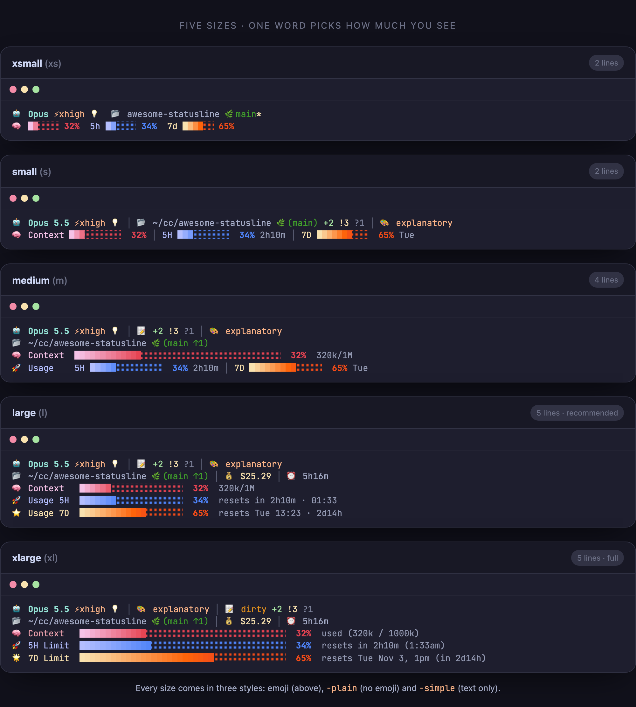
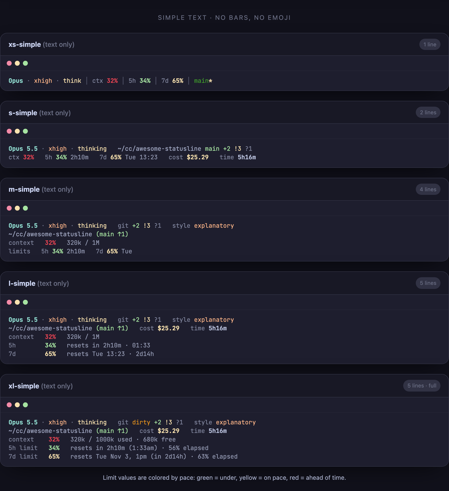
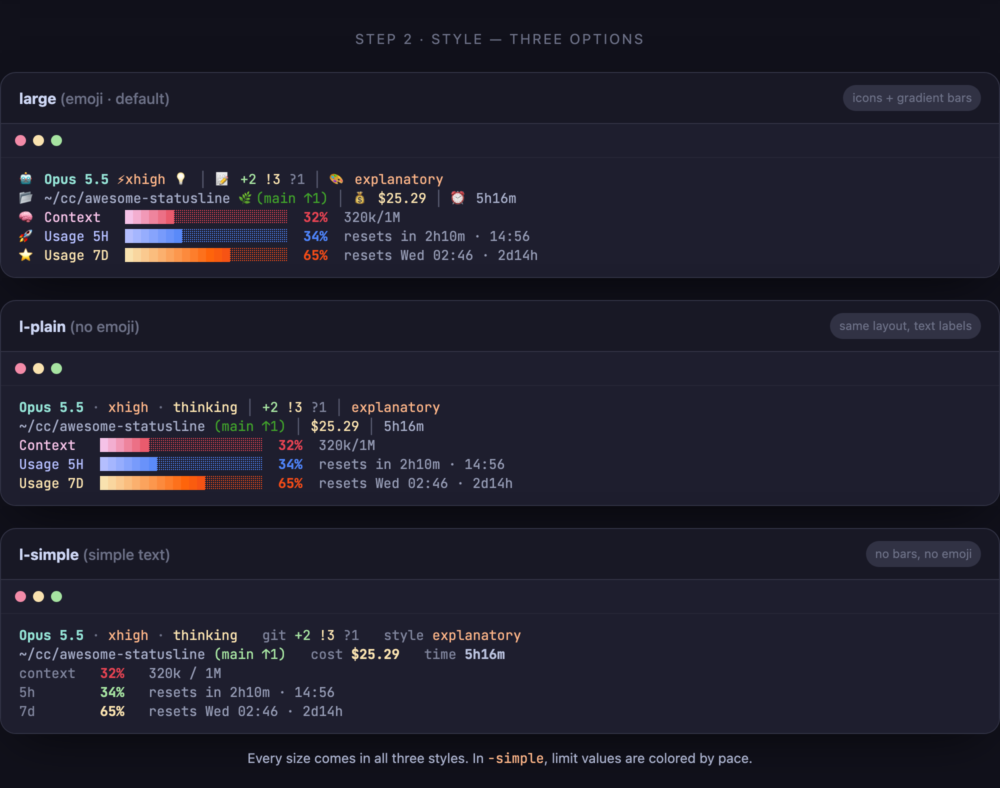

<!-- gitreels:start -->
<p align="center">
  <a href="https://gitreels.com/awesomezun/claude-statusline"></a>
  <br>
  <a href="https://gitreels.com"></a>
  <a href="https://gitreels.com/awesomezun/claude-statusline"></a>
</p>
<!-- gitreels:end -->

<div align="center">

# ⚡ Awesome Statusline

**A beautiful statusline for [Claude Code](https://claude.com/claude-code) — context, usage limits, cost & reasoning `⚡effort`, all at a glance. One line to install on macOS, Linux & Windows.**

[🇰🇷 한국어](README.ko.md) · [Quick Install](#-quick-install) · [Presets](#-presets) · [What it shows](#-what-it-shows) · [FAQ](#-faq)


<br/><br/>




<sub>▶ <a href="https://awesomezun.github.io/claude-statusline/">Interactive live demo</a></sub>

</div>

---

## 🆕 What's new

Built to keep pace with Claude Code — recent updates:

| Date | Update |
|------|--------|
| **2026-11-01** | **Three styles for every size** — the text-only style now covers all five sizes (`m-simple`, `l-simple`, `xl-simple` are new); `simple` / `oneline` became `s-simple` / `xs-simple` (old names still work) · installs ask size, then style |
| **2026-10-31** | **Ultra plan support + redesign** — Ultra has no 5-hour limit, so it now gets a weekly bar with a per-day budget (the bars used to freeze at `0% (loading..)`) · every size redesigned: aligned columns, fixed-width %, resets shown as *in 2h10m · 01:50*, empty fields hidden · **no-emoji option** for every size (`-plain`) · two new text presets, **`simple`** and **`oneline`** · one renderer for every preset, ~4× faster per refresh |
| **2026-10-17** | **Windows on non-English locales** — the statusline no longer drops to `Unknown` / 0% when Claude Code sends non-ASCII text (e.g. a Korean session name) · context gauge guards against stale window-size reports |
| **2026-06-03** | **Install size picker** — installing through Claude Code always asks which of the five presets you want (`large` recommended) |
| **2026-06-02** | **Windows native renderer** — PowerShell statusline path, no Git Bash or `jq` required on Windows |
| **2026-05-31** | **Opus 4.8** support · reasoning **effort** (`high`/`xhigh`/`max`) + **thinking** indicators · one-line cross-platform installer · 5 size presets (`xs`–`xl`) · JetBrains Mono |
| **2026-04-01** | **1M-token context window** support (Opus) · usage bars render before the first chat |
| **2026-01-19** | Multi-mode display system · plugin marketplace |
| **2026-01-18** | Catppuccin gradient bars · live **5h / 7d** usage-limit monitoring |

---

## Highlights

- ⚡ **Reasoning effort & thinking** — shows `/effort` (`high`/`xhigh`/`max`) and extended thinking, live from Claude Code's official statusline JSON (and hidden on models that don't support effort).
- 📊 **Every plan's limits** — Pro / Max get 5-hour + weekly bars with time to reset; **Ultra** (weekly only) gets a weekly bar with a per-day budget.
- 🔤 **Three styles** — every size comes with emoji, without emoji (`-plain`), or as plain text with no bars (`-simple`).
- 🖥️ **No Node, no Nerd Font** — Bash on macOS/Linux, native PowerShell on Windows; macOS/Linux auto-install `jq` if needed.
- 📐 **Five sizes** — `xs` to `xl`: pick how much you see with one word.

> There are several great Claude Code statuslines out there — this one leans into reasoning-effort/thinking visibility and zero-setup, cross-platform install.

---

## 🚀 Quick Install

You don't need Node. On Windows, you also don't need `jq`, Git, or Git Bash — the installer uses PowerShell.

**macOS / Linux**
```bash
curl -fsSL https://raw.githubusercontent.com/awesomezun/claude-statusline/main/install.sh | bash
```

**Windows (PowerShell)**
```powershell
irm https://raw.githubusercontent.com/awesomezun/claude-statusline/main/install.ps1 | iex
```

If your security software blocks `irm | iex`, download the installer first, inspect it, then run it:
```powershell
Invoke-WebRequest -Uri https://raw.githubusercontent.com/awesomezun/claude-statusline/main/install.ps1 -OutFile .\install.ps1
notepad .\install.ps1
powershell -NoProfile -ExecutionPolicy Bypass -File .\install.ps1
```

To choose a preset, append it explicitly:
```bash
curl -fsSL https://raw.githubusercontent.com/awesomezun/claude-statusline/main/install.sh | bash -s -- l-plain
```

**Or clone and run**:
```bash
git clone https://github.com/awesomezun/claude-statusline.git && cd claude-statusline
./install.sh            # macOS / Linux
./install.ps1           # Windows PowerShell
```

Use any preset explicitly — a size as abbreviation **or** full name (`xs`/`xsmall`, `s`/`small`, `m`/`medium`, `l`/`large`, `xl`/`xlarge`), optionally with a style: `-plain` (no emoji) or `-simple` (text only), e.g. `l-plain`, `m-simple`.
Then restart Claude Code. That's it.

---

## 📐 Presets

**Five sizes × three styles.** One word picks how much you see; an optional suffix picks the style.

| Size | Lines | At a glance |
|------|:-----:|-------------|
| `xsmall` (`xs`) | 2 | model · effort · thinking · folder · branch · 3 small bars |
| `small` (`s`) | 2 | + labels, percentages, time to reset, output style |
| `medium` (`m`) | 4 | full-width context bar, git state |
| `large` (`l`) | 5 | + cost, session time, reset times — **recommended** |
| `xlarge` (`xl`) | 5 | everything: 40-block bars, full reset dates |

| Style | Example | What changes |
|-------|---------|--------------|
| emoji (default) | `large` | icons + gradient bars |
| `-plain` | `l-plain` | same layout and bars, text labels instead of icons — steadiest in tmux, SSH and Windows consoles |
| `-simple` | `l-simple` | text only: no bars, no emoji; limit values colored by pace (`xs-simple` fits on one line) |

`simple` and `oneline` keep working as aliases of `s-simple` and `xs-simple`.

### Simple text

<div align="center">

</div>

### Three styles · Pro / Max & Ultra

The Ultra plan has no 5-hour limit, so the weekly line takes its place, with a per-day budget (`≈22%/day` = how much you can use per day and still stay under the weekly limit). Pro / Max keep 5H + 7D. Nothing to configure — the statusline follows whatever limits Claude Code reports.

<div align="center">

</div>

> 🔤 Curious how it looks in *your* font? See the **[12-font showcase →](demo.md)** — 10 cross-platform mono fonts plus Menlo and MesloLGS.

<details>
<summary>📋 Plain-text preview (copy-paste friendly)</summary>
<br/>

Colors render live in your terminal:

```text
xsmall ─ 2 lines
🤖 Opus ⚡xhigh 💡  📂 awesome-statusline 🌿main*
🧠 ██░░░░ 32%  5h ██░░░░ 34%  7d ████░░ 65%

small ─ 2 lines
🤖 Opus 5.5 ⚡xhigh 💡 │ 📂 ~/cc/awesome-statusline 🌿(main) +2 !3 ?1 │ 🎨 explanatory
🧠 Context ███░░░░░░░  32% │ 5H ███░░░░░░░  34% 2h10m │ 7D ███████░░░  65% Tue

medium ─ 4 lines
🤖 Opus 5.5 ⚡xhigh 💡 │ 📝 +2 !3 ?1 │ 🎨 explanatory
📂 ~/cc/awesome-statusline 🌿(main ↑1)
🧠 Context  █████████████░░░░░░░░░░░░░░░░░░░░░░░░░░░  32%  320k/1M
🚀 Usage    5H █████░░░░░░░░░  34% 2h10m │ 7D █████████░░░░░  65% Tue

large ─ 5 lines
🤖 Opus 5.5 ⚡xhigh 💡 │ 📝 +2 !3 ?1 │ 🎨 explanatory
📂 ~/cc/awesome-statusline 🌿(main ↑1) │ 💰 $25.29 │ ⏰ 5h16m
🧠 Context   ██████░░░░░░░░░░░░░░  32%  320k/1M
🚀 Usage 5H  ███████░░░░░░░░░░░░░  34%  resets in 2h10m · 01:50
⭐ Usage 7D  █████████████░░░░░░░  65%  resets Tue 12:40 · 2d14h

xlarge ─ 5 lines
🤖 Opus 5.5 ⚡xhigh 💡 │ 🎨 explanatory │ 📝 dirty +2 !3 ?1
📂 ~/cc/awesome-statusline 🌿(main ↑1) │ 💰 $25.29 │ ⏰ 5h16m
🧠 Context   █████████████░░░░░░░░░░░░░░░░░░░░░░░░░░░  32%  used (320k / 1000k)
🚀 5H Limit  ██████████████░░░░░░░░░░░░░░░░░░░░░░░░░░  34%  resets in 2h10m (1:50am)
🌟 7D Limit  ██████████████████████████░░░░░░░░░░░░░░  65%  resets Tue Nov 3, 12pm (in 2d14h)

large on Ultra ─ weekly only
🤖 Opus 5.5 ⚡xhigh 💡 │ 📝 +2 !3 ?1 │ 🎨 explanatory
📂 ~/cc/awesome-statusline 🌿(main ↑1) │ 💰 $25.29 │ ⏰ 5h16m
🧠 Context   ██████░░░░░░░░░░░░░░  32%  320k/1M
⭐ Weekly    ██████████░░░░░░░░░░  48%  resets Tue 08:40 · 2d10h · ≈22%/day

l-plain ─ no emoji
Opus 5.5 · xhigh · thinking │ +2 !3 ?1 │ explanatory
~/cc/awesome-statusline (main ↑1) │ $25.29 │ 5h16m
Context   ██████░░░░░░░░░░░░░░  32%  320k/1M
Usage 5H  ███████░░░░░░░░░░░░░  34%  resets in 2h10m · 01:50
Usage 7D  █████████████░░░░░░░  65%  resets Tue 12:40 · 2d14h

xs-simple ─ text only, 1 line
Opus · xhigh · think │ ctx 32% │ 5h 34% │ 7d 65% │ main*

s-simple ─ text only, 2 lines
Opus 5.5 · xhigh · thinking   ~/cc/awesome-statusline main +2 !3 ?1
ctx 32%   5h 34% 2h10m   7d 65% Tue 12:40   cost $25.29   time 5h16m

l-simple ─ text only, 5 lines
Opus 5.5 · xhigh · thinking   git +2 !3 ?1   style explanatory
~/cc/awesome-statusline (main ↑1)   cost $25.29   time 5h16m
context   32%   320k / 1M
5h        34%   resets in 2h10m · 01:50
7d        65%   resets Tue 12:40 · 2d14h

l-simple on Ultra ─ weekly only
Opus 5.5 · xhigh · thinking   git +2 !3 ?1   style explanatory
~/cc/awesome-statusline (main ↑1)   cost $25.29   time 5h16m
context   32%   320k / 1M
week      48%   resets Tue 08:40 · 2d10h · 22%/day
```

</details>

---

## 🎨 What it shows

| Element | Meaning |
|---------|---------|
| 🤖 **Model** | Current model (`Opus 5.5`, …) |
| ⚡ **Effort** | Reasoning effort — `low`/`medium`/`high`/`xhigh`/`max`. Live with `/effort`. Hidden if the model has no effort param. |
| 💡 **Thinking** | Extended thinking is on for the session |
| 🎨 **Style** | Active output style (hidden while it's `default`) |
| 🌿 **Git** | Branch, ahead ↑ / behind ↓, staged `+` · modified `!` · untracked `?` |
| 🐍 **Env** | Active conda / virtualenv (only when one is active) |
| 🧠 **Context** | Context-window usage bar with token count |
| 💰 **Cost / ⏰ Time** | Session cost (USD) and duration |
| 🚀 **5H / ⭐ 7D** | Usage-limit bars with time to reset (Pro / Max) |
| ⭐ **Weekly** | Ultra (no 5-hour limit): weekly bar + per-day budget (`≈22%/day`) |

In the `-simple` style, limit values are colored by **pace** — usage compared with how much of the window has passed: green = under pace, yellow = on pace, red = ahead of time (or ≥ 90%).

All colors follow the [Catppuccin](https://catppuccin.com/) palette. No Nerd Font required — every glyph is a standard emoji/Unicode block.

---

## 🔧 Change size or remove

**Change preset** — just re-run the installer with a new one (or ask your AI agent to reinstall):
```bash
./install.sh m          # or: curl … | bash -s -- m
./install.sh l-plain    # same size, no emoji
./install.sh l-simple   # same size, text only
```

**Uninstall** — remove the `statusLine` entry from `~/.claude/settings.json` (a timestamped backup is created on every install) and delete `~/.claude/awesome-statusline.sh` or `~/.claude/awesome-statusline.ps1`.

---

## ✅ Requirements

| Dependency | Why | Installed via |
|-----------|-----|---------------|
| `jq` *(macOS/Linux only)* | parse the Bash statusline JSON | brew / apt / dnf / pacman / zypper / apk |
| PowerShell *(Windows built-in)* | parse and render the Windows statusline | included with Windows |

On Windows, the installer writes a native `awesome-statusline.ps1` and points Claude Code at `powershell -NoProfile ...`. That avoids Git Bash, `.sh` file association issues, and `jq` PATH problems.

---

## 🙋 FAQ

**Does it slow Claude Code down?** No — it's a small local script that runs per refresh.

**I don't see `⚡effort`.** Your current model doesn't expose the effort parameter, so the field is intentionally hidden. Switch to a model that supports `/effort` (e.g. Opus 5.5).

**Usage bars stuck at `loading..`, or only a Weekly bar shows?** `loading..` appears until Claude Code sends the first usage data of the session (after your first message), and only for claude.ai subscribers. On the **Ultra** plan there is no 5-hour limit, so you get one **Weekly** bar with a per-day budget — that's expected. If the bars stayed at `loading..` on Ultra, update to the latest version: just ask your AI agent to reinstall.

**Why emoji instead of Nerd Font icons?** So it looks right out of the box on any terminal, with zero font setup.

**Can I turn the emoji off?** Yes — add `-plain` to any size for the same layout without emoji (`l-plain`), or `-simple` for plain text with no bars (`l-simple`).

**Where are my old settings?** Every install backs up `settings.json` to `settings.json.backup-<timestamp>` before touching it.

**Statusline is blank, or blank terminal windows keep popping up (Windows)?** Re-run `./install.ps1` — it now installs a native PowerShell renderer and removes the Git Bash / `jq` dependency from the statusline path. Details: [TROUBLESHOOTING.md](TROUBLESHOOTING.md).

**Characters stack vertically inside tmux?** Enable truecolor in `~/.tmux.conf` (`set -ga terminal-overrides ",xterm-256color:RGB"`) and reload tmux. Details: [TROUBLESHOOTING.md](TROUBLESHOOTING.md).

---

## 🧩 Or install via the plugin marketplace

Prefer Claude Code's plugin system? It's also published as a marketplace plugin:

```
/plugin marketplace add awesomezun/claude-statusline
/plugin install awesome-statusline
```

Then run `/statusline-setup` to apply it, or pass any preset like `/statusline-setup xl`, `/statusline-setup l-plain` or `/statusline-setup m-simple`. The one-line `install.sh` above is the primary path; this is just an alternative.

---

<div align="center">

Built with 🩵 for the Claude Code community · [Catppuccin](https://catppuccin.com/) theme · MIT License

⭐ **Star it if it made your terminal nicer.**


<a href="https://www.star-history.com/?repos=AwesomeJun%2FCC-statusline&type=date&legend=top-left">
 <picture>
   <source media="(prefers-color-scheme: dark)" srcset="https://api.star-history.com/chart?repos=AwesomeJun/CC-statusline&type=date&theme=dark&legend=top-left&sealed_token=ntTNhwQ951y6lOVznUbvdeYGCi23yOBbRnadWt5pMTIRfdp6L3KPB1Dwy65vNWI7CIY4R1MzU6yloqyfkwmlEbMoguscV-kFRG5PCqCVyP4_G4XgShBDtg" />
   <source media="(prefers-color-scheme: light)" srcset="https://api.star-history.com/chart?repos=AwesomeJun/CC-statusline&type=date&legend=top-left&sealed_token=ntTNhwQ951y6lOVznUbvdeYGCi23yOBbRnadWt5pMTIRfdp6L3KPB1Dwy65vNWI7CIY4R1MzU6yloqyfkwmlEbMoguscV-kFRG5PCqCVyP4_G4XgShBDtg" />
   
 </picture>
</a>

</div>
