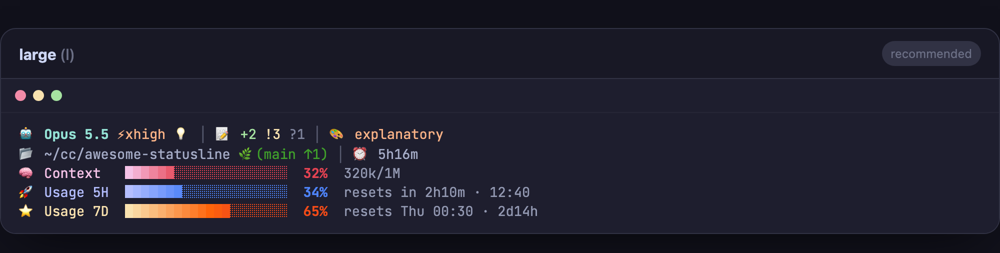
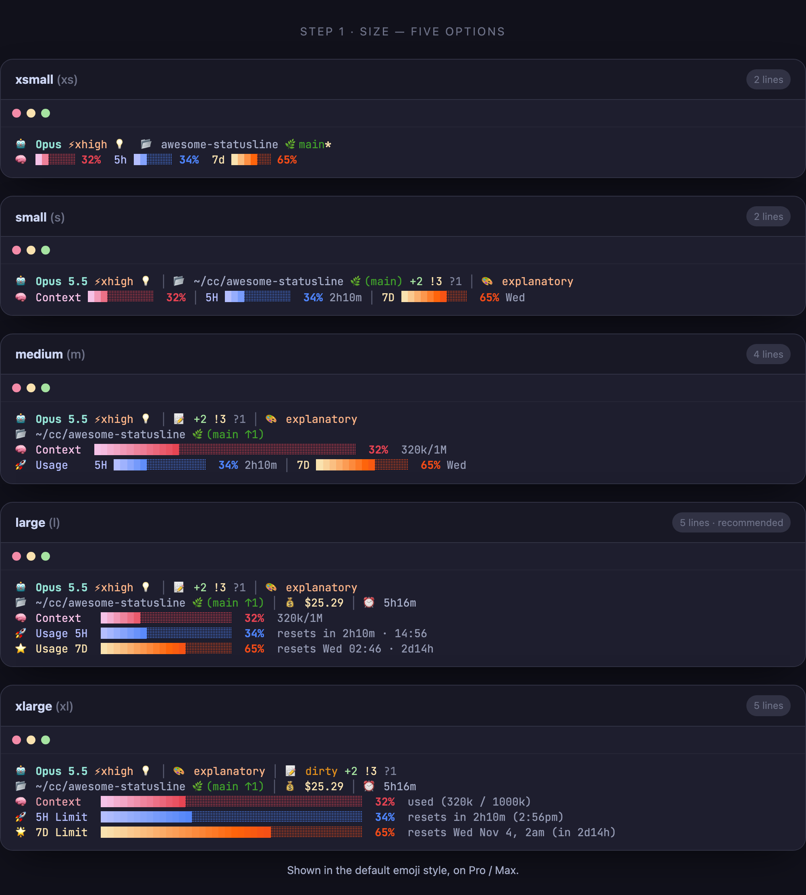
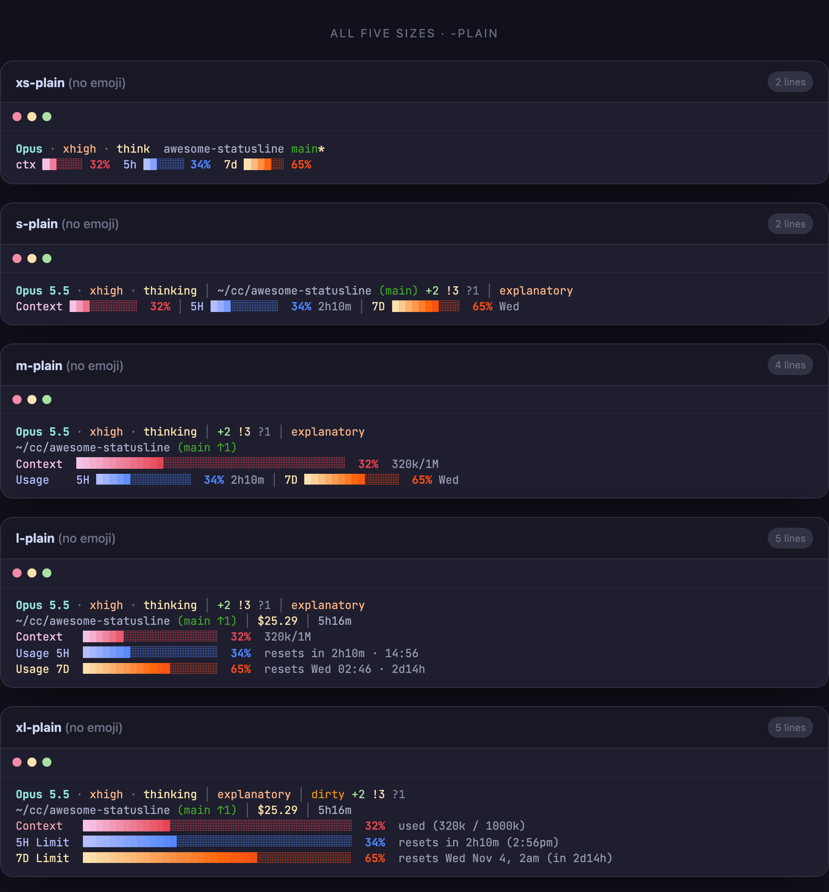
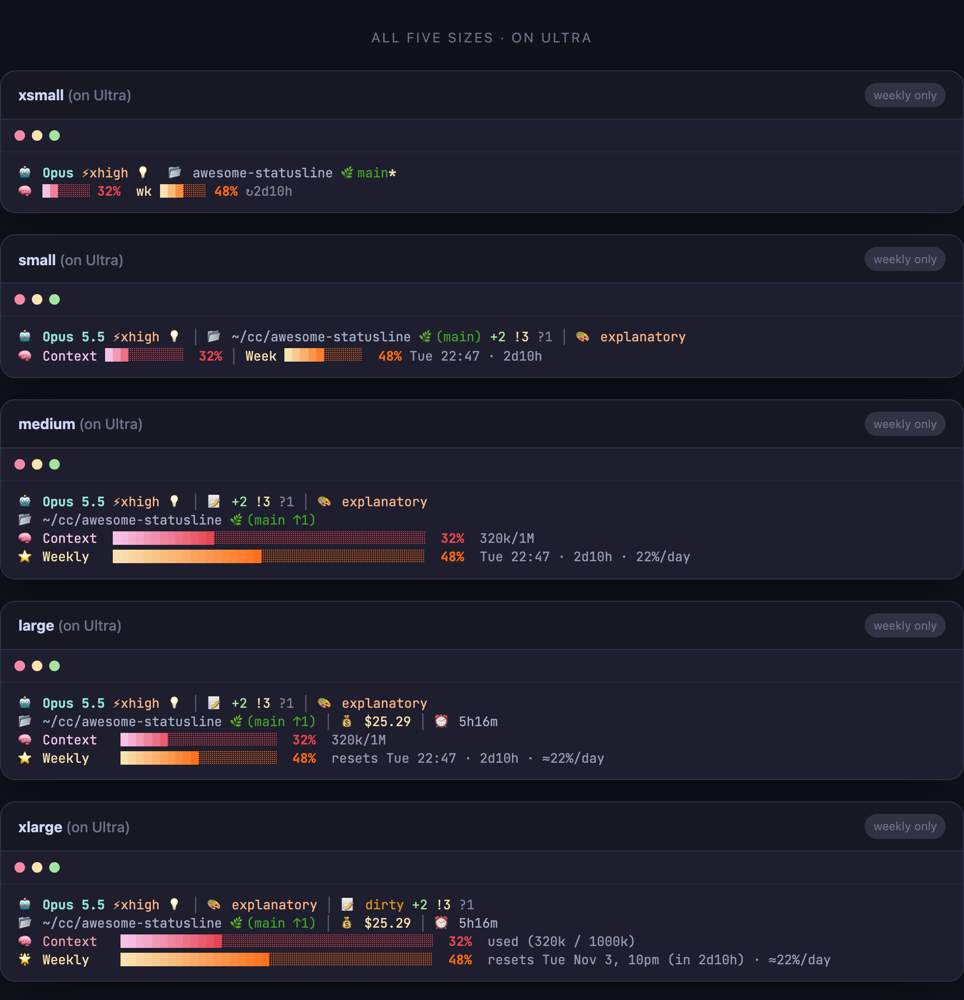

<!-- gitreels:start -->
<p align="center">
  
  <br>
  <a href="https://gitreels.com"></a>
  <a href="https://gitreels.com/awesomezun/claude-statusline"></a>
</p>
<!-- gitreels:end -->

<div align="center">

# ⚡ Awesome Statusline

**A statusline for [Claude Code](https://claude.com/claude-code) that shows model · reasoning effort · context · usage limits · cost at a glance.**<br/>
One line to install on macOS, Linux and Windows.

[🇰🇷 한국어](README.ko.md) · [At a glance](#overview) · [Install](#install) · [Size](#sizes) · [Style](#styles) · [Plan](#plans) · [What it shows](#fields) · [FAQ](#faq)


<br/><br/>



<sub>▶ <a href="https://awesomezun.github.io/claude-statusline/">Live demo</a> · 🆕 <b>v3.5.1</b> Ultra plan support · 5 sizes × 3 styles → <a href="#changelog">Changelog</a></sub>

</div>

---

<a id="overview"></a>

## 🧭 At a glance

**You choose two things when you install: a size and a style. You don't choose a plan — the statusline adapts to it on its own.**

| | What it decides | Options | Who decides |
|---|---|---|---|
| **1. [Size](#sizes)** | how much you see | `xsmall` · `small` · `medium` · `large` · `xlarge` (5) | you, at install |
| **2. [Style](#styles)** | how it looks | emoji · no emoji · simple text (3) | you, at install |
| **3. [Plan](#plans)** | which usage limits show | Pro · Max → 5-hour + weekly<br/>Ultra → weekly + per-day budget | **automatic** — nothing to choose |

A size plus a style is a **preset**. There are 5 × 3 = **15**; you pick one.

| Size ↓ · Style → | Emoji (default) | No emoji | Simple text |
|---|---|---|---|
| **xsmall** · 2 lines | `xsmall` | `xsmall-plain` | `xsmall-simple` (1 line) |
| **small** · 2 lines | `small` | `small-plain` | `small-simple` |
| **medium** · 4 lines | `medium` | `medium-plain` | `medium-simple` |
| **large** · 5 lines ⭐ recommended | **`large`** | `large-plain` | `large-simple` |
| **xlarge** · 5 lines | `xlarge` | `xlarge-plain` | `xlarge-simple` |

- A size on its own means the emoji style: `large` is large with emoji.
- Sizes can be abbreviated (`xs` · `s` · `m` · `l` · `xl`): `l-plain` = `large-plain`, `m-simple` = `medium-simple`.
- The older names `simple` and `oneline` still work; they are `small-simple` and `xsmall-simple`.
- New here? Start with **`large`**. You can switch any time.

---

<a id="install"></a>

## 🚀 Install

### Option 1. Ask your AI agent (easiest)

Tell Claude Code:

```text
Install https://github.com/awesomezun/claude-statusline
```

It asks for a size and a style, then installs. Name a preset up front (`… with large-plain`) and it installs straight away.

### Option 2. One line in the terminal

**macOS / Linux**
```bash
curl -fsSL https://raw.githubusercontent.com/awesomezun/claude-statusline/main/install.sh | bash
```

**Windows (PowerShell)**
```powershell
irm https://raw.githubusercontent.com/awesomezun/claude-statusline/main/install.ps1 | iex
```

The installer asks for a size (1–5), then a style (1–3). Already know your preset? Append it:

```bash
curl -fsSL https://raw.githubusercontent.com/awesomezun/claude-statusline/main/install.sh | bash -s -- large-plain
```

Then **restart Claude Code**.

<details>
<summary>Other ways to install: clone · when security software blocks it on Windows · plugin marketplace</summary>
<br/>

**Clone and run**
```bash
git clone https://github.com/awesomezun/claude-statusline.git && cd claude-statusline
./install.sh large-plain      # macOS / Linux (leave out the preset to be asked)
./install.ps1 large-plain     # Windows PowerShell
```

**If security software blocks `irm | iex` on Windows**, download the installer, read it, then run it:
```powershell
Invoke-WebRequest -Uri https://raw.githubusercontent.com/awesomezun/claude-statusline/main/install.ps1 -OutFile .\install.ps1
notepad .\install.ps1
powershell -NoProfile -ExecutionPolicy Bypass -File .\install.ps1
```

**Plugin marketplace**
```
/plugin marketplace add awesomezun/claude-statusline
/plugin install awesome-statusline
```
Then run `/statusline-setup`, or pass a preset directly: `/statusline-setup large-plain`.

</details>

---

<a id="sizes"></a>

## 📐 1. Size: pick one of five

How much you see, and in how many lines. Smallest at the top, most detailed at the bottom.

| Size | Lines | Shows |
|---|:-:|---|
| `xsmall` (`xs`) | 2 | model · effort · folder · branch, three small bars |
| `small` (`s`) | 2 | + full path, git changes, output style, time to reset |
| `medium` (`m`) | 4 | + wide context bar with token count, commits ahead |
| **`large` (`l`)** | 5 | + cost, session time, one line per limit with reset time (**recommended**) |
| `xlarge` (`xl`) | 5 | + 40-block bars everywhere, full reset dates |

<div align="center">

</div>

---

<a id="styles"></a>

## 🎨 2. Style: pick one of three

Added after the size name. Every size comes in all three styles.

| Style | Suffix | Example | Looks like |
|---|---|---|---|
| **Emoji** (default) | none | `large` | icons + gradient bars |
| **No emoji** | `-plain` | `large-plain` | same layout and bars, no icons |
| **Simple text** | `-simple` | `large-simple` | text and numbers only (no bars, no emoji) |

<div align="center">

</div>

- `-plain` drops only the emoji; everything else is identical. It's the steadiest choice where emoji widths drift: tmux, SSH, Windows consoles.
- `-simple` is laid out for text, so the fields differ a little by size — `xsmall-simple`, for example, leaves out the folder to fit on one line.
- **Simple-text colors** compare usage with how much of the limit window has passed: green = under pace, yellow = on pace, red = ahead of time (or ≥ 90%). Used 34% with 56% of the 5-hour window gone? Green.

<details>
<summary>🖼️ All five sizes: no emoji (<code>-plain</code>)</summary>
<br/>
<div align="center">

</div>
</details>

<details>
<summary>🖼️ All five sizes: simple text (<code>-simple</code>)</summary>
<br/>
<div align="center">

</div>
</details>

---

<a id="plans"></a>

## 📊 3. Plan: automatic

**Nothing to choose.** Each plan has different usage limits, Claude Code passes the statusline only the ones your plan has, and the statusline draws exactly those. All 15 presets work this way, and switching plans never needs a reinstall.

| Plan | Limits Claude Code sends | What the statusline shows |
|---|---|---|
| **Pro · Max** | 5-hour + weekly | a `5H` bar and a `7D` bar, each with its reset time |
| **Ultra** | weekly only (no 5-hour limit) | one `Weekly` bar, its reset time, and a **per-day budget** |

The **per-day budget** (`≈22%/day`) is the weekly allowance you have left divided by the days until it resets: use about that much per day and you won't hit the limit before the reset. With less than a day to go it shows what's left instead, e.g. `9% left`.

<div align="center">

</div>

<details>
<summary>🖼️ All five sizes: on Ultra</summary>
<br/>
<div align="center">

</div>
</details>

<details>
<summary>📋 Plain-text preview (copy-paste friendly)</summary>
<br/>

Colors render live in your terminal.

```text
xsmall ─ 2 lines
🤖 Opus ⚡xhigh 💡  📂 awesome-statusline 🌿main*
🧠 ██░░░░ 32%  5h ██░░░░ 34%  7d ████░░ 65%

small ─ 2 lines
🤖 Opus 5.5 ⚡xhigh 💡 │ 📂 ~/cc/awesome-statusline 🌿(main) +2 !3 ?1 │ 🎨 explanatory
🧠 Context ███░░░░░░░  32% │ 5H ███░░░░░░░  34% 2h10m │ 7D ███████░░░  65% Wed

medium ─ 4 lines
🤖 Opus 5.5 ⚡xhigh 💡 │ 📝 +2 !3 ?1 │ 🎨 explanatory
📂 ~/cc/awesome-statusline 🌿(main ↑1)
🧠 Context  █████████████░░░░░░░░░░░░░░░░░░░░░░░░░░░  32%  320k/1M
🚀 Usage    5H █████░░░░░░░░░  34% 2h10m │ 7D █████████░░░░░  65% Wed

large ─ 5 lines (recommended)
🤖 Opus 5.5 ⚡xhigh 💡 │ 📝 +2 !3 ?1 │ 🎨 explanatory
📂 ~/cc/awesome-statusline 🌿(main ↑1) │ 💰 $25.29 │ ⏰ 5h16m
🧠 Context   ██████░░░░░░░░░░░░░░  32%  320k/1M
🚀 Usage 5H  ███████░░░░░░░░░░░░░  34%  resets in 2h10m · 14:57
⭐ Usage 7D  █████████████░░░░░░░  65%  resets Wed 02:47 · 2d14h

xlarge ─ 5 lines
🤖 Opus 5.5 ⚡xhigh 💡 │ 🎨 explanatory │ 📝 dirty +2 !3 ?1
📂 ~/cc/awesome-statusline 🌿(main ↑1) │ 💰 $25.29 │ ⏰ 5h16m
🧠 Context   █████████████░░░░░░░░░░░░░░░░░░░░░░░░░░░  32%  used (320k / 1000k)
🚀 5H Limit  ██████████████░░░░░░░░░░░░░░░░░░░░░░░░░░  34%  resets in 2h10m (2:57pm)
🌟 7D Limit  ██████████████████████████░░░░░░░░░░░░░░  65%  resets Wed Nov 4, 2am (in 2d14h)

large-plain ─ no emoji
Opus 5.5 · xhigh · thinking │ +2 !3 ?1 │ explanatory
~/cc/awesome-statusline (main ↑1) │ $25.29 │ 5h16m
Context   ██████░░░░░░░░░░░░░░  32%  320k/1M
Usage 5H  ███████░░░░░░░░░░░░░  34%  resets in 2h10m · 14:57
Usage 7D  █████████████░░░░░░░  65%  resets Wed 02:47 · 2d14h

large-simple ─ simple text
Opus 5.5 · xhigh · thinking   git +2 !3 ?1   style explanatory
~/cc/awesome-statusline (main ↑1)   cost $25.29   time 5h16m
context   32%   320k / 1M
5h        34%   resets in 2h10m · 14:57
7d        65%   resets Wed 02:47 · 2d14h

xsmall-simple ─ simple text, 1 line
Opus · xhigh · think │ ctx 32% │ 5h 34% │ 7d 65% │ main*

large ─ on Ultra (weekly only)
🤖 Opus 5.5 ⚡xhigh 💡 │ 📝 +2 !3 ?1 │ 🎨 explanatory
📂 ~/cc/awesome-statusline 🌿(main ↑1) │ 💰 $25.29 │ ⏰ 5h16m
🧠 Context   ██████░░░░░░░░░░░░░░  32%  320k/1M
⭐ Weekly    ██████████░░░░░░░░░░  48%  resets Tue 22:47 · 2d10h · ≈22%/day

large-simple ─ on Ultra (weekly only)
Opus 5.5 · xhigh · thinking   git +2 !3 ?1   style explanatory
~/cc/awesome-statusline (main ↑1)   cost $25.29   time 5h16m
context   32%   320k / 1M
week      48%   resets Tue 22:47 · 2d10h · 22%/day
```

</details>

---

<a id="fields"></a>

## 🔍 What it shows

| Element | Meaning |
|---------|---------|
| 🤖 **Model** | Current model (`Opus 5.5`, …) |
| ⚡ **Effort** | Reasoning effort: `low` · `medium` · `high` · `xhigh` · `max`. Live with `/effort`; hidden on models without effort |
| 💡 **Thinking** | Extended thinking is on |
| 🎨 **Output style** | Active output style (hidden while it's `default`) |
| 📂 🌿 **Folder · Git** | Folder, branch, commits ahead ↑ / behind ↓, staged `+` · modified `!` · untracked `?` files |
| 🐍 **Env** | Active conda / virtualenv (only when one is active) |
| 🧠 **Context** | Context-window usage bar and token count |
| 💰 **Cost** · ⏰ **Time** | Session cost (USD) and duration |
| 🚀 **5H** · ⭐ **7D** | 5-hour and weekly limit usage with reset times (Pro · Max) |
| ⭐ **Weekly** | Weekly limit usage, reset time and per-day budget (Ultra) |

The no-emoji and simple-text styles use text labels such as `Context`, `Usage 5H` and `cost` in place of the icons. Colors follow the [Catppuccin](https://catppuccin.com/) palette, and every glyph is a standard emoji or Unicode block — no Nerd Font needed.

---

<a id="change"></a>

## 🔧 Change preset or uninstall

**Change**: give your AI agent this repo's URL and the preset you want, and it reinstalls (e.g. `Switch https://github.com/awesomezun/claude-statusline to medium-simple`). From a terminal, re-run the installer with the new preset:

```bash
curl -fsSL https://raw.githubusercontent.com/awesomezun/claude-statusline/main/install.sh | bash -s -- medium-simple
```

**Uninstall**: remove the `statusLine` entry from `~/.claude/settings.json` and delete `~/.claude/awesome-statusline.sh` (`awesome-statusline.ps1` on Windows). Every install also leaves a `settings.json.backup-<timestamp>` you can restore.

---

<a id="requirements"></a>

## ✅ Requirements

| | macOS · Linux | Windows |
|---|---|---|
| Runs on | Bash 3.2+ (built in) | PowerShell 5.1+ (built in) |
| JSON parsing | `jq` (the installer adds it via brew / apt / dnf / pacman / zypper / apk if missing) | not needed |
| Not needed | Node, Nerd Font | Node, Nerd Font, Git Bash, `jq` |

On Windows the installer writes a native `awesome-statusline.ps1` and points Claude Code at `powershell -NoProfile …`, which avoids Git Bash, `.sh` file associations and `jq` PATH problems.

---

<a id="faq"></a>

## 🙋 FAQ

**Do I need to reinstall when I change plans?** No. The statusline follows the limits Claude Code reports, so it shows 5H + 7D on Pro · Max and Weekly on Ultra by itself.

**The limit lines say `loading..`.** Usage data arrives after your first message in a session, so `loading..` shows until then. It only arrives when you're signed in with a claude.ai subscription (Pro · Max · Ultra); with an API key it stays at `loading..`. On Ultra, if it's still `loading..` after your first message, you have an old version — ask your AI agent to reinstall.

**I'm on Ultra and see only one Weekly bar.** That's expected: Ultra has no 5-hour limit.

**I don't see `⚡effort`.** Your current model doesn't support effort, so the field is hidden on purpose. Switch to a model that supports `/effort` (e.g. Opus 5.5).

**Can I turn the emoji off?** Yes. Add `-plain` to any size for the same layout without emoji (`large-plain`), or `-simple` for text with no bars (`large-simple`).

**Does it slow Claude Code down?** No. It's a small local script that takes about 0.1 s per refresh.

**Why emoji instead of Nerd Font icons?** So it looks right out of the box in any terminal, with no font setup. See how it looks in your font in the [12-font showcase](demo.md).

**Where are my old settings?** Every install backs up `settings.json` to `settings.json.backup-<timestamp>` before changing it.

**Bars look banded or yellow turns olive inside tmux.** Claude Code drops to 256 colours inside tmux. The statusline notices and draws 256-colour gradients instead; for the full gradient, set `"env": {"CLAUDE_CODE_TMUX_TRUECOLOR": "1"}` in `~/.claude/settings.json` (the installer does it when tmux supports 24-bit colour). Details: [TROUBLESHOOTING.md](TROUBLESHOOTING.md)

**Characters stack vertically inside tmux.** Enable truecolor in `~/.tmux.conf` (`set -ga terminal-overrides ",xterm-256color:RGB"`) and reload tmux. Details: [TROUBLESHOOTING.md](TROUBLESHOOTING.md)

**The statusline is blank, or blank terminal windows keep popping up (Windows).** Re-run `install.ps1`. It switches to the native PowerShell renderer and drops the Git Bash / `jq` dependency. Details: [TROUBLESHOOTING.md](TROUBLESHOOTING.md)

---

<a id="changelog"></a>

## 🆕 Changelog

Built to keep pace with Claude Code. Full notes for each release are on [Releases](https://github.com/awesomezun/claude-statusline/releases).

| Date | Update |
|------|--------|
| **2026‑11‑01** | **v3.5.1** · three styles for every size (simple text `m-simple`, `l-simple`, `xl-simple` added) · installs ask size, then style · **clean gradients inside tmux** (when Claude Code drops to 256 colours the bars use 256-colour gradients, and the installer turns on `CLAUDE_CODE_TMUX_TRUECOLOR` when tmux supports 24-bit colour) · fixed the first bar cell darkening on light themes with minimum contrast (VS Code, Orca) · README reorganized around "two choices (size, style) + one automatic (plan)" |
| **2026‑10‑31** | **Ultra plan support + redesign** · Ultra has no 5-hour limit, so it gets a weekly bar with a per-day budget (the bars used to freeze at `0% (loading..)`) · every size redesigned (aligned columns, fixed-width %, resets shown as *in 2h10m · 01:50*, empty fields hidden) · no-emoji style (`-plain`) · text presets `simple` and `oneline` · one renderer for every preset, ~4× faster per refresh |
| **2026‑10‑17** | **Windows on non-English locales** · no more `Unknown` / 0% when Claude Code sends non-ASCII text (e.g. a Korean session name) · context gauge guards against stale window-size reports |
| **2026‑06‑03** | **Install size picker** · installing through Claude Code always asks for a size (`large` recommended) |
| **2026‑06‑02** | **Windows native renderer** · PowerShell statusline, no Git Bash or `jq` needed on Windows |
| **2026‑05‑31** | **Opus 4.8** support · reasoning **effort** (`high`/`xhigh`/`max`) and **thinking** indicators · one-line cross-platform installer · 5 sizes (`xs`–`xl`) · JetBrains Mono |
| **2026‑04‑01** | **1M-token context window** support (Opus) · usage bars render before the first chat |
| **2026‑01‑19** | Multi-mode display system · plugin marketplace |
| **2026‑01‑18** | Catppuccin gradient bars · live **5h / 7d** usage-limit monitoring |

---

<div align="center">

Built with 🩵 for the Claude Code community · [Catppuccin](https://catppuccin.com/) theme · MIT License

⭐ **Star it if it made your terminal nicer.**


<a href="https://www.star-history.com/?repos=AwesomeJun%2FCC-statusline&type=date&legend=top-left">
 <picture>
   <source media="(prefers-color-scheme: dark)" srcset="https://api.star-history.com/chart?repos=AwesomeJun/CC-statusline&type=date&theme=dark&legend=top-left&sealed_token=ntTNhwQ951y6lOVznUbvdeYGCi23yOBbRnadWt5pMTIRfdp6L3KPB1Dwy65vNWI7CIY4R1MzU6yloqyfkwmlEbMoguscV-kFRG5PCqCVyP4_G4XgShBDtg" />
   <source media="(prefers-color-scheme: light)" srcset="https://api.star-history.com/chart?repos=AwesomeJun/CC-statusline&type=date&legend=top-left&sealed_token=ntTNhwQ951y6lOVznUbvdeYGCi23yOBbRnadWt5pMTIRfdp6L3KPB1Dwy65vNWI7CIY4R1MzU6yloqyfkwmlEbMoguscV-kFRG5PCqCVyP4_G4XgShBDtg" />
   
 </picture>
</a>

</div>
