<div align="center">

# ⚡ Awesome Statusline

**Model · reasoning effort · context · prompt cache · usage limits, at a glance: a statusline for [Claude Code](https://claude.com/claude-code), now in the Claude desktop app too.**<br/>
One line to install on macOS, Linux and Windows.


<br/><br/>

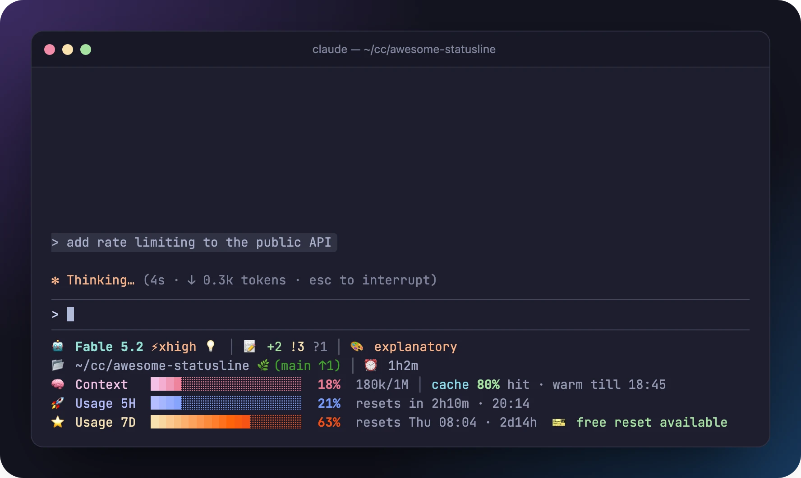

<br/><br/>

<a href="#install"></a>&nbsp;<a href="#desktop"></a>&nbsp;<a href="#presets"></a>&nbsp;<a href="https://awesomezun.github.io/claude-statusline/"></a>

[🇰🇷 한국어](README.ko.md) · [Desktop & cockpit](#desktop) · [v3.7](#v37) · [At a glance](#overview) · [Install](#install) · [Presets](#presets) · [Plan](#plans) · [Mods](#mods) · [What it shows](#fields) · [FAQ](#faq)

</div>

---

<a id="desktop"></a>

## ✨ New: in the Claude desktop app, with a cockpit

<div align="center">
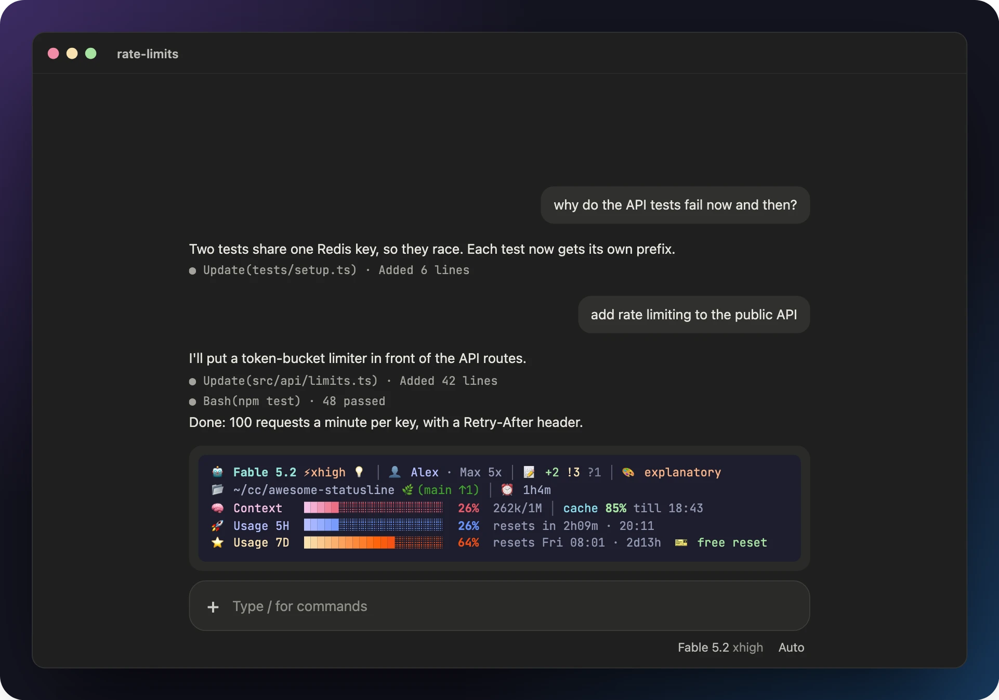
</div>

<table>
<tr>
<td width="33%" valign="top">

**🖥️ The desktop app**<br/>
Its Code tab doesn't run a `statusLine`. As a mod, all 15 presets draw in a band above the prompt there, and in the terminal.

</td>
<td width="33%" valign="top">

**🛩️ `/cockpit`**<br/>
A pane beside the chat, drawn like [1top](https://1top.si)'s menu bar: dials, fuel gauges, a radial token chart, every session and limit. Dark or light.

</td>
<td width="33%" valign="top">

**⚡ One flag**<br/>
Add `--mods` to the install line, or pick *Mods* when the installer asks. → [Mods](#mods) · [Cockpit](#cockpit)

</td>
</tr>
</table>

<div align="center">
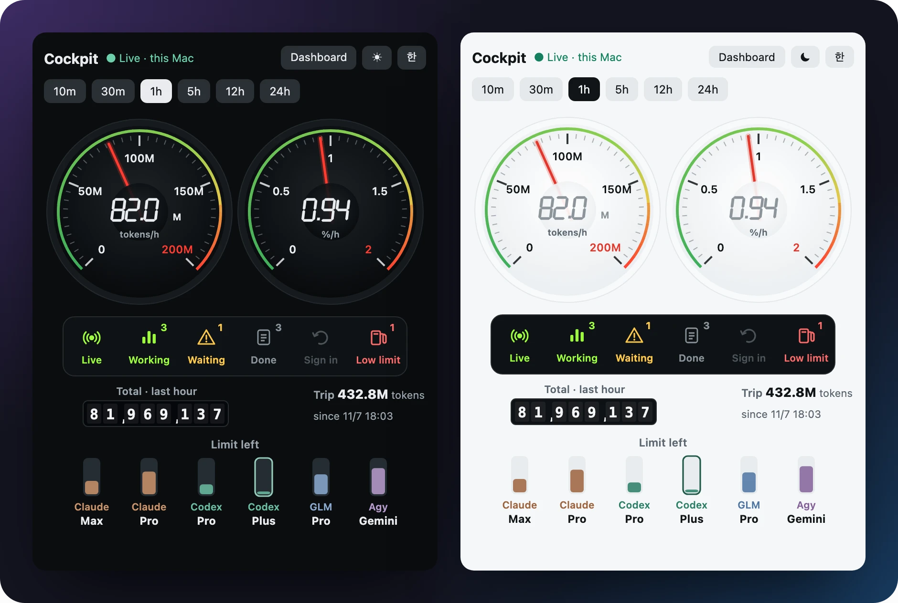

<sub>Beta: needs a Claude Code with mods (early access), on macOS or Linux.</sub>
</div>

<a id="v37"></a>

## 🆕 v3.7: Fable 5.2, the prompt cache, free limit resets

<div align="center">
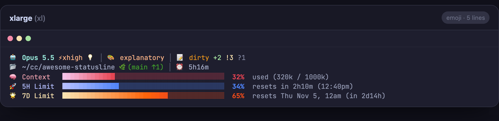
</div>

<table>
<tr>
<td width="33%" valign="top">

**🧠 Fable 5.2**<br/>
Claude Code's new default Fable model, with its effort and its 1M context. Fable 5.1 and the Mythos models read the same way, in the band and the cockpit too.

</td>
<td width="33%" valign="top">

**💾 Prompt cache**<br/>
How much input came from the cache (`cache 92%`), until when it stays warm, and once it's cold what your next turn writes again. In every preset; xlarge gives it a line.

</td>
<td width="33%" valign="top">

**🎫 Free limit resets**<br/>
When claude.ai has given you a free limit reset you haven't used, the limits line ends with a 🎫 mark. Use it from Settings › Usage on the web or in the desktop app. → [FAQ](#faq)

</td>
</tr>
</table>

---

<a id="overview"></a>

## 🧭 At a glance

**15 presets: 5 sizes × 3 styles.** When you install, you pick a size (how much you see) and a style (how it looks). Your plan isn't a choice: Ultra included, it's applied automatically.

<div align="center">
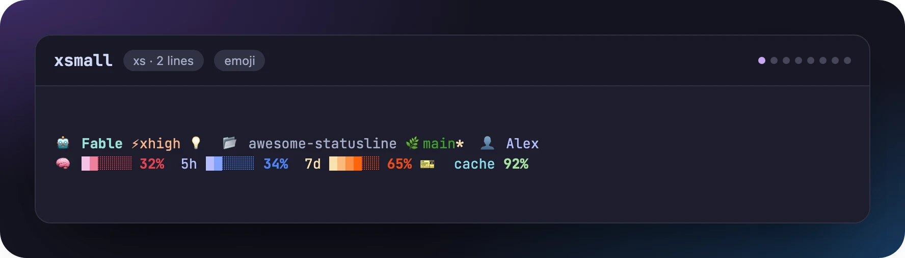
</div>

| Size ↓ · Style → | Emoji (default) | No emoji | Simple text |
|---|---|---|---|
| **[xsmall](#xsmall)** · 2 lines | `xsmall` | `xsmall-plain` | `xsmall-simple` (1 line) |
| **[small](#small)** · 2 lines | `small` | `small-plain` | `small-simple` |
| **[medium](#medium)** · 4 lines | `medium` | `medium-plain` | `medium-simple` |
| **[large](#large)** · 5 lines ⭐ recommended | **`large`** | `large-plain` | `large-simple` |
| **[xlarge](#xlarge)** · 6 lines | `xlarge` | `xlarge-plain` | `xlarge-simple` |

- **Emoji** is the default: icons and gradient bars. A size on its own means this style (`large`).
- **No emoji** (`-plain`) keeps the layout and the bars and drops only the emoji. It's the steadiest choice where emoji widths drift: tmux, SSH, Windows consoles.
- **Simple text** (`-simple`) is text and numbers only, so the fields differ a little by size. Its colors compare usage with how much of the limit window has passed: green = under pace, yellow = on pace, red = ahead of time (or ≥ 90%).
- Sizes can be abbreviated (`xs` · `s` · `m` · `l` · `xl`): `l-plain` = `large-plain`. The older names `simple` and `oneline` are `small-simple` and `xsmall-simple`.
- New here? Start with **`large`**. You can switch any time.

Want it in the Claude desktop app too? Install it as a [mod (beta)](#mods).

> [!NOTE]
> **Ultra is applied automatically.** Ultra has no 5-hour limit, so on Ultra every preset shows one weekly line with a per-day budget in place of the 5H and 7D lines. There's nothing to pick, and changing plans never needs a reinstall. → [Plan](#plans)

---

<a id="install"></a>

## 🚀 Install

### Option 1. Ask your AI agent (easiest)

Tell Claude Code:

```text
Install https://github.com/awesomezun/claude-statusline
```

It asks for a size, a style and where to show it, then installs. Name a preset up front (`… with large-plain`) and it installs straight away.

### Option 2. One line in the terminal

**macOS / Linux**
```bash
curl -fsSL https://raw.githubusercontent.com/awesomezun/claude-statusline/main/install.sh | bash
```

**Windows (PowerShell)**
```powershell
irm https://raw.githubusercontent.com/awesomezun/claude-statusline/main/install.ps1 | iex
```

The installer asks for a size (1–5), a style (1–3), then where to show it (1 Statusline, 2 [Mods](#mods); macOS / Linux). Already know your preset? Append it:

```bash
curl -fsSL https://raw.githubusercontent.com/awesomezun/claude-statusline/main/install.sh | bash -s -- large-plain
```

Then **restart Claude Code**.

<details>
<summary>Other ways to install: clone · when security software blocks it on Windows · plugin marketplace</summary>
<br/>

**Clone and run**
```bash
git clone https://github.com/awesomezun/claude-statusline.git && cd claude-statusline
./install.sh large-plain      # macOS / Linux (leave out the preset to be asked)
./install.ps1 large-plain     # Windows PowerShell
```

**If security software blocks `irm | iex` on Windows**, download the installer, read it, then run it:
```powershell
Invoke-WebRequest -Uri https://raw.githubusercontent.com/awesomezun/claude-statusline/main/install.ps1 -OutFile .\install.ps1
notepad .\install.ps1
powershell -NoProfile -ExecutionPolicy Bypass -File .\install.ps1
```

**Plugin marketplace**
```
/plugin marketplace add awesomezun/claude-statusline
/plugin install awesome-statusline
```
Then run `/statusline-setup`, or pass a preset directly: `/statusline-setup large-plain`.

</details>

---

<a id="presets"></a>

## 🎨 The 15 presets

Each size in its three styles: emoji, no emoji (`-plain`) and simple text (`-simple`). Shown on Pro / Max; for Ultra, see [Plan](#plans).

<a id="xsmall"></a>

### xsmall (`xs`) · 2 lines

Model · effort · folder · branch, and three small bars. The simple-text style fits on one line.

<div align="center">
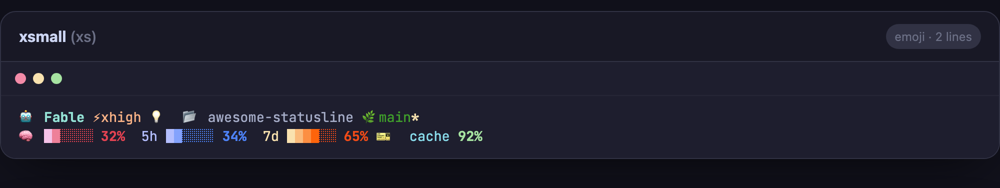
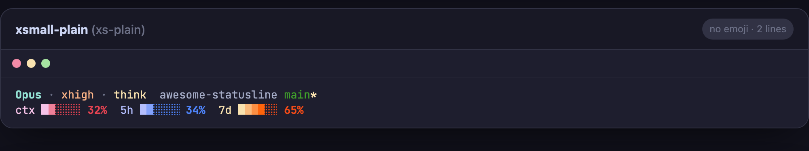
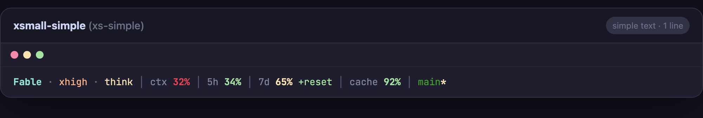
</div>

<a id="small"></a>

### small (`s`) · 2 lines

Adds the full path, git changes, output style and time to reset.

<div align="center">
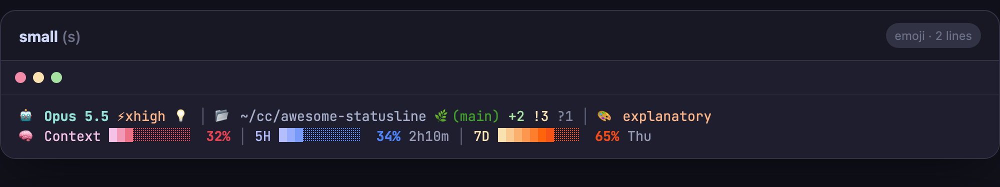
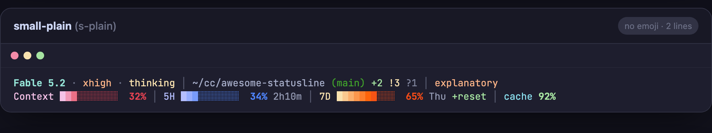
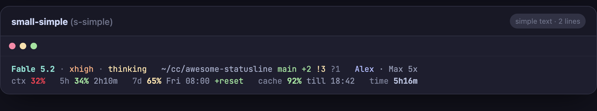
</div>

<a id="medium"></a>

### medium (`m`) · 4 lines

Adds a wide context bar with the token count, and commits ahead.

<div align="center">
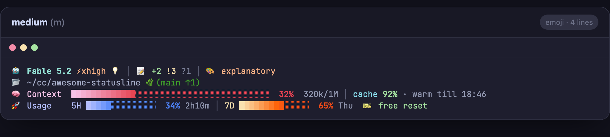
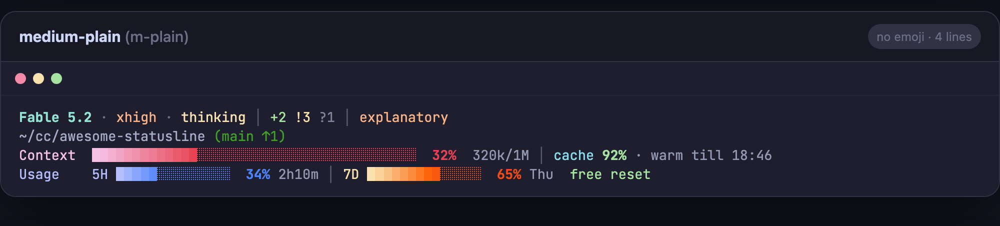
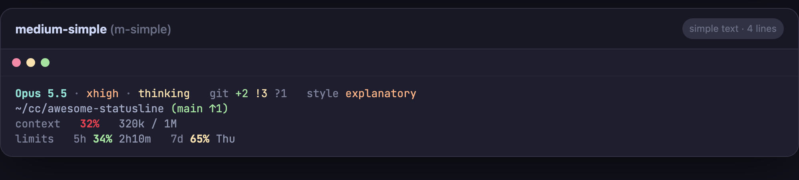
</div>

<a id="large"></a>

### large (`l`) · 5 lines ⭐ recommended

Adds the session time, and one line per limit with its reset time.

<div align="center">
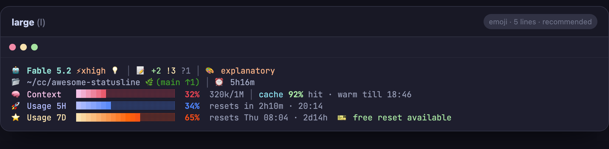
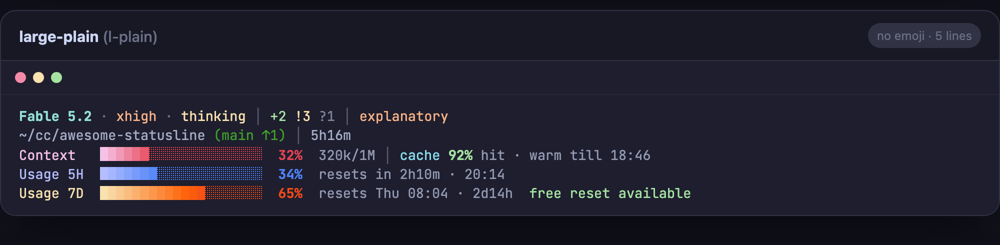
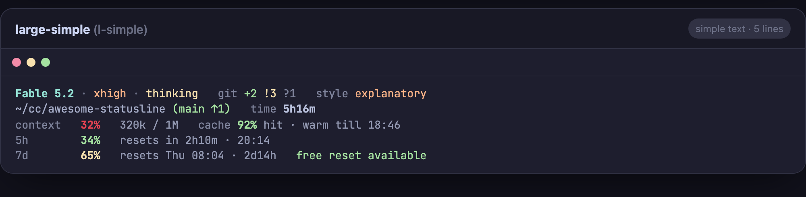
</div>

<a id="xlarge"></a>

### xlarge (`xl`) · 6 lines

Adds a prompt cache line with its misses, 40-block bars everywhere and full reset dates.

<div align="center">

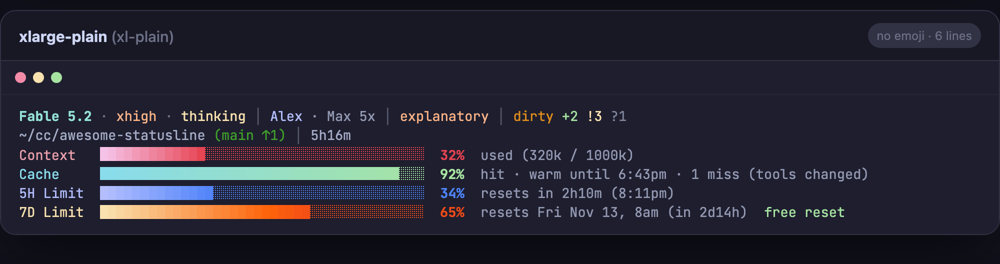
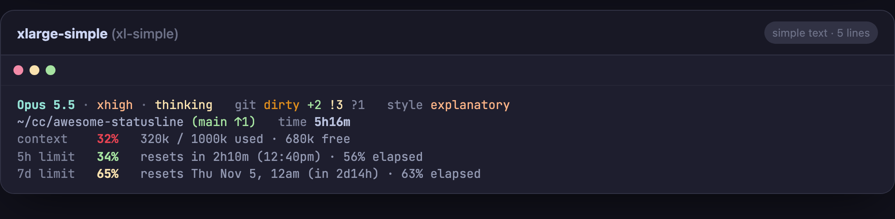
</div>

---

<a id="plans"></a>

## 📊 Plan: automatic, Ultra included

**Nothing to choose.** Each plan has different usage limits, Claude Code passes the statusline only the ones your plan has, and the statusline draws exactly those. All 15 presets work this way, and switching plans never needs a reinstall.

| Plan | Limits Claude Code sends | What the statusline shows |
|---|---|---|
| **Pro · Max** | 5-hour + weekly | a `5H` bar and a `7D` bar, each with its reset time |
| **Ultra** | weekly only (no 5-hour limit) | one `Weekly` bar, its reset time, and a **per-day budget** |

The **per-day budget** (`≈22%/day`) is the weekly allowance you have left divided by the days until it resets: use about that much per day and you won't hit the limit before the reset. With less than a day to go it shows what's left instead, e.g. `9% left`.

<div align="center">
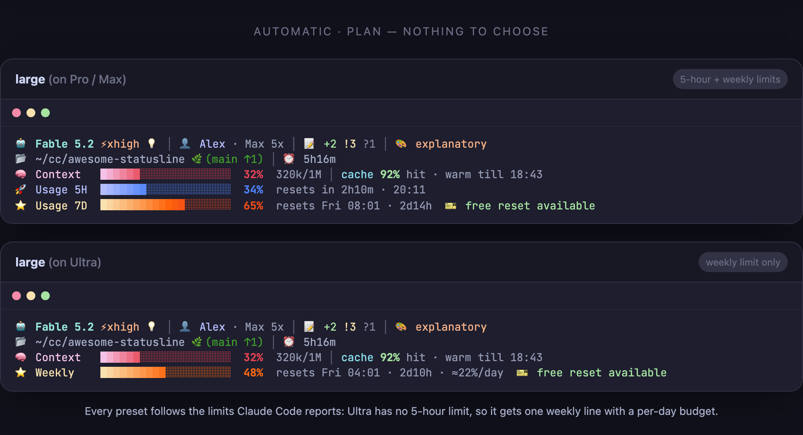
</div>

---

<a id="mods"></a>

## 🧩 Mods (beta): also in the Claude desktop app

The statusline is a `statusLine` command, and the Claude desktop app's Code tab doesn't run one. **Mods** draws the same lines in the band above the prompt instead, through a Claude Code mod (early access), and that band shows in the desktop app too.

<div align="center">
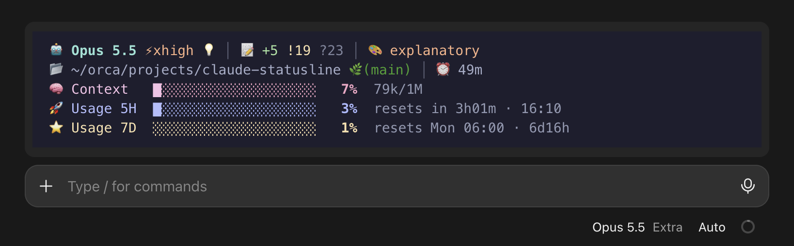
</div>

| | Statusline (default) | Mods (beta) |
|---|---|---|
| Where | under the prompt, in the terminal | in a band above the prompt: the terminal and the Claude desktop app |
| Presets | all 15 | all 15 (the mod runs the same renderer) |
| Runs on | macOS · Linux · Windows | macOS · Linux |
| Needs | Claude Code | a Claude Code with mods (early access; tested on 2.1.316 and on 2.1.309, the one the desktop app ships) and its `claude` CLI |

**Install**: pick "Mods" when the installer asks where it should show, tell your AI agent (`Install https://github.com/awesomezun/claude-statusline as a mod`), or add `--mods`:

```bash
curl -fsSL https://raw.githubusercontent.com/awesomezun/claude-statusline/main/install.sh | bash -s -- large --mods
```

Then start a new session, in the terminal or in the desktop app's Code tab.

- The installer copies the mod to `~/.claude/awesome-statusline-mod/` and installs it with `claude plugin install` as `awesome-statusline-mod@awesome-statusline-local`. The preset is the mod's `preset` option.
- It removes an Awesome Statusline `statusLine`, so the terminal doesn't show the lines twice. Any other statusLine is left alone; while one is set, the terminal keeps it and the band shows only in the desktop app. Change this with the `terminal` option (`auto` · `show` · `hide`) in `/plugin configure awesome-statusline-mod@awesome-statusline-local`.
- Until your first message in a session, effort comes from your settings and the usage rows may read `loading..`; from the first reply on they show the session's real values.
- The VS Code extension has no band above the prompt, so the mod doesn't show there.
- **Back to the statusline**: reinstall without `--mods`. **Remove the mod**: `claude plugin uninstall awesome-statusline-mod@awesome-statusline-local`, then delete `~/.claude/awesome-statusline-mod/`.

<a id="cockpit"></a>

### Cockpit pane (prototype)

With the mod installed, **`/cockpit`** opens a pane beside the chat drawn like [1top](https://1top.si)'s menu bar, in a dark and a light theme:

- **Cluster**: two dials (tokens per hour, and weekly limit used per hour), a status strip (working, waiting, done, sign-in, low limit), an odometer with a trip counter, and what is left of each limit as fuel gauges.
- **Dashboard**: a radial token chart around the hour, the model mix, and account cards with use per hour and a day's trend.
- **Below either**: sessions (ranked by weekly limit used), token flow, limits, usage map, heatmap, resources, and this session (context, where each limit ends up at the pace so far, the tools running now). There's also a *Compact now* button.
- **Period** from 10 minutes to 24 hours. The view, theme, period and language are buttons at the top and stay as you left them.

With the 1top app running on the same computer, the cockpit reads 1top's local read-only API and shows every AI it tracks: Claude Code, Codex and the rest. Without it, it shows this computer's resources and the Claude Code sessions running the mod. While the cockpit is open, the band above the prompt steps aside. To open it at the start of every session, set the mod's `cockpit` option to `auto`. The desktop app draws it as graphics, the terminal as text.

<div align="center">
<table>
<tr><th>Cluster · dark</th><th>Dashboard · dark</th></tr>
<tr><td>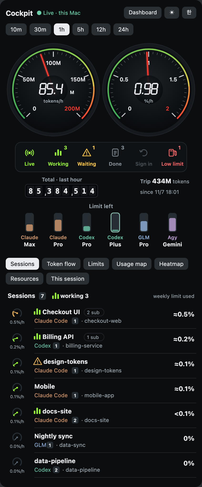</td><td>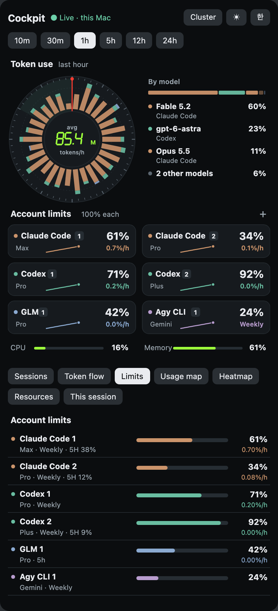</td></tr>
<tr><th>Cluster · light</th><th>Dashboard · light</th></tr>
<tr><td>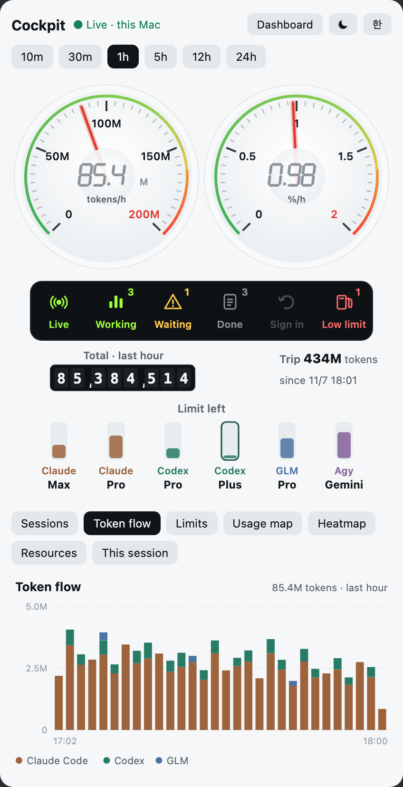</td><td>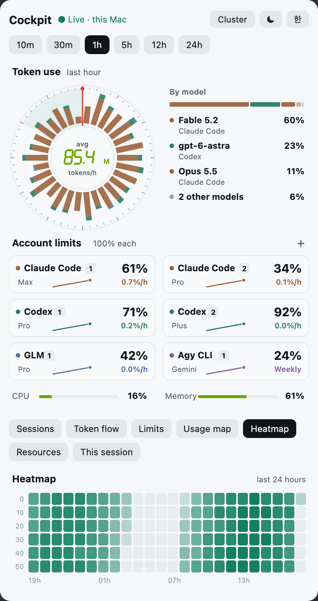</td></tr>
</table>
</div>

---

<a id="fields"></a>

## 🔍 What it shows

| Element | Meaning |
|---------|---------|
| 🤖 **Model** | Current model (`Fable 5.2`, `Opus 5.5`, …) |
| ⚡ **Effort** | Reasoning effort: `low` · `medium` · `high` · `xhigh` · `max`. Live with `/effort`; hidden on models without effort |
| 💡 **Thinking** | Extended thinking is on |
| 🎨 **Output style** | Active output style (hidden while it's `default`) |
| 📂 🌿 **Folder · Git** | Folder, branch, commits ahead ↑ / behind ↓, staged `+` · modified `!` · untracked `?` files |
| 🐍 **Env** | Active conda / virtualenv (only when one is active) |
| 🧠 **Context** | Context-window usage bar and token count |
| 💾 **Cache** | Share of input read from the prompt cache (green from 80%, yellow from 50%), until when it stays warm, and once it's cold what the next turn writes again. Shows after the first reply (Claude Code 2.1.251+) |
| ⏰ **Time** | Session duration |
| 🚀 **5H** · ⭐ **7D** | 5-hour and weekly limit usage with reset times (Pro · Max) |
| ⭐ **Weekly** | Weekly limit usage, reset time and per-day budget (Ultra) |
| 🎫 **Free reset** | You hold a free limit reset from claude.ai that you haven't used (see the [FAQ](#faq)) |

The no-emoji and simple-text styles use text labels such as `Context`, `Usage 5H` and `time` in place of the icons. Colors follow the [Catppuccin](https://catppuccin.com/) palette, and every glyph is a standard emoji or Unicode block — no Nerd Font needed.

---

<a id="change"></a>

## 🔧 Change preset or uninstall

**Change**: give your AI agent this repo's URL and the preset you want, and it reinstalls (e.g. `Switch https://github.com/awesomezun/claude-statusline to medium-simple`). From a terminal, re-run the installer with the new preset:

```bash
curl -fsSL https://raw.githubusercontent.com/awesomezun/claude-statusline/main/install.sh | bash -s -- medium-simple
```

**Uninstall**: remove the `statusLine` entry from `~/.claude/settings.json` and delete `~/.claude/awesome-statusline.sh` (`awesome-statusline.ps1` on Windows). Every install also leaves a `settings.json.backup-<timestamp>` you can restore. Installed as a mod? See [Mods (beta)](#mods).

---

<a id="requirements"></a>

## ✅ Requirements

| | macOS · Linux | Windows |
|---|---|---|
| Runs on | Bash 3.2+ (built in) | PowerShell 5.1+ (built in) |
| JSON parsing | `jq` (the installer adds it via brew / apt / dnf / pacman / zypper / apk if missing) | not needed |
| Not needed | Node, Nerd Font | Node, Nerd Font, Git Bash, `jq` |

On Windows the installer writes a native `awesome-statusline.ps1` and points Claude Code at `powershell -NoProfile …`, which avoids Git Bash, `.sh` file associations and `jq` PATH problems.

---

<a id="faq"></a>

## 🙋 FAQ

**Do I need to reinstall when I change plans?** No. The statusline follows the limits Claude Code reports, so it shows 5H + 7D on Pro · Max and Weekly on Ultra by itself.

**The limit lines say `loading..`.** Usage data arrives after your first message in a session, so `loading..` shows until then. It only arrives when you're signed in with a claude.ai subscription (Pro · Max · Ultra); with an API key it stays at `loading..`. On Ultra, if it's still `loading..` after your first message, you have an old version — ask your AI agent to reinstall.

**I'm on Ultra and see only one Weekly bar.** That's expected: Ultra has no 5-hour limit.

**I don't see `⚡effort`.** Your current model doesn't support effort, so the field is hidden on purpose. Switch to a model that supports `/effort` (e.g. Opus 5.5).

**What does `cache 92%` mean, and why does it say `cold`?** Claude Code caches the start of your conversation, so the next turn reads it back instead of processing it again: reads are cheaper and count less toward your limits. `92%` is the share of this session's input that came from the cache. The cache stays warm for a while after each turn (5 minutes or an hour); past that it's `cold`, and the next turn writes the whole conversation again, the size shown after `re-caches`. A `miss` is a turn that processed again what the cache already held; xlarge names the likely cause (a tool or the system prompt changed, idle past the TTL).

**Does it show how many free limit resets I have?** It shows whether you have one, not how many. claude.ai hands out free limit resets now and then; you use them from Settings › Usage on the web or in the desktop app, not from Claude Code. The statusline JSON doesn't carry them; Claude Code notes in its `~/.claude.json` only whether your account holds an unused one, and the 🎫 mark reads that. The count is only behind your login, and the statusline never touches your credentials. Nothing is sent anywhere.

**Can I turn the emoji off?** Yes. Add `-plain` to any size for the same layout without emoji (`large-plain`), or `-simple` for text with no bars (`large-simple`).

**Does it work in the Claude desktop app?** With [Mods (beta)](#mods), yes. The desktop app's Code tab doesn't run `statusLine` commands, but it draws the mod's band above the prompt.

**Does it slow Claude Code down?** No. It's a small local script that takes about 0.1 s per refresh.

**Why emoji instead of Nerd Font icons?** So it looks right out of the box in any terminal, with no font setup. See how it looks in your font in the [12-font showcase](demo.md).

**Where are my old settings?** Every install backs up `settings.json` to `settings.json.backup-<timestamp>` before changing it.

**Bars look banded or yellow turns olive inside tmux.** Claude Code drops to 256 colours inside tmux. The statusline notices and draws 256-colour gradients instead; for the full gradient, set `"env": {"CLAUDE_CODE_TMUX_TRUECOLOR": "1"}` in `~/.claude/settings.json` (the installer does it when tmux supports 24-bit colour). Details: [TROUBLESHOOTING.md](TROUBLESHOOTING.md)

**Characters stack vertically inside tmux.** Enable truecolor in `~/.tmux.conf` (`set -ga terminal-overrides ",xterm-256color:RGB"`) and reload tmux. Details: [TROUBLESHOOTING.md](TROUBLESHOOTING.md)

**The statusline is blank, or blank terminal windows keep popping up (Windows).** Re-run `install.ps1`. It switches to the native PowerShell renderer and drops the Git Bash / `jq` dependency. Details: [TROUBLESHOOTING.md](TROUBLESHOOTING.md)

---

<a id="changelog"></a>

## 🆕 Changelog

Built to keep pace with Claude Code. Full notes for each release are on [Releases](https://github.com/awesomezun/claude-statusline/releases).

| Date | Update |
|------|--------|
| **2026‑11‑09** | **v3.7.0** · **Fable 5.2** support (and the Mythos models, in the band and the cockpit) · **prompt cache** in every preset: hit ratio, warm until, and what a cold cache writes again; xlarge gets a cache line with misses and their likely cause · **free limit reset** mark when you hold an unused one · the mod works the cache figures out from each request, so the desktop app shows them too · README with motion reels and a desktop & cockpit section up front |
| **2026‑11‑02** | **v3.6.0** · **Mods (beta)** · install as a Claude Code mod with `--mods`: the same 15 presets in the band above the prompt, so it also shows in the Claude desktop app (macOS / Linux) · the installer asks where it should show · `/cockpit` pane (prototype): 1top-style cluster and dashboard, dark and light, with accounts, token flow, usage map and running sessions · README shows the 15 presets size by size |
| **2026‑11‑01** | **v3.5.1** · three styles for every size (simple text `m-simple`, `l-simple`, `xl-simple` added) · installs ask size, then style · **clean gradients inside tmux** (when Claude Code drops to 256 colours the bars use 256-colour gradients, and the installer turns on `CLAUDE_CODE_TMUX_TRUECOLOR` when tmux supports 24-bit colour) · fixed the first bar cell darkening on light themes with minimum contrast (VS Code, Orca) · README reorganized around "two choices (size, style) + one automatic (plan)" |
| **2026‑10‑31** | **Ultra plan support + redesign** · Ultra has no 5-hour limit, so it gets a weekly bar with a per-day budget (the bars used to freeze at `0% (loading..)`) · every size redesigned (aligned columns, fixed-width %, resets shown as *in 2h10m · 01:50*, empty fields hidden) · no-emoji style (`-plain`) · text presets `simple` and `oneline` · one renderer for every preset, ~4× faster per refresh |
| **2026‑10‑17** | **Windows on non-English locales** · no more `Unknown` / 0% when Claude Code sends non-ASCII text (e.g. a Korean session name) · context gauge guards against stale window-size reports |
| **2026‑06‑03** | **Install size picker** · installing through Claude Code always asks for a size (`large` recommended) |
| **2026‑06‑02** | **Windows native renderer** · PowerShell statusline, no Git Bash or `jq` needed on Windows |
| **2026‑05‑31** | **Opus 4.8** support · reasoning **effort** (`high`/`xhigh`/`max`) and **thinking** indicators · one-line cross-platform installer · 5 sizes (`xs`–`xl`) · JetBrains Mono |
| **2026‑04‑01** | **1M-token context window** support (Opus) · usage bars render before the first chat |
| **2026‑01‑19** | Multi-mode display system · plugin marketplace |
| **2026‑01‑18** | Catppuccin gradient bars · live **5h / 7d** usage-limit monitoring |

---

<div align="center">

Built with 🩵 for the Claude Code community · [Catppuccin](https://catppuccin.com/) theme · MIT License

<sub>Awesome Statusline is an independent community project, not affiliated with or endorsed by Anthropic. Claude and Claude Code are trademarks of Anthropic, PBC.</sub>

⭐ **Star it if it made your terminal nicer.**


<a href="https://www.star-history.com/?repos=AwesomeJun%2FCC-statusline&type=date&legend=top-left">
 <picture>
   <source media="(prefers-color-scheme: dark)" srcset="https://api.star-history.com/chart?repos=AwesomeJun/CC-statusline&type=date&theme=dark&legend=top-left&sealed_token=ntTNhwQ951y6lOVznUbvdeYGCi23yOBbRnadWt5pMTIRfdp6L3KPB1Dwy65vNWI7CIY4R1MzU6yloqyfkwmlEbMoguscV-kFRG5PCqCVyP4_G4XgShBDtg" />
   <source media="(prefers-color-scheme: light)" srcset="https://api.star-history.com/chart?repos=AwesomeJun/CC-statusline&type=date&legend=top-left&sealed_token=ntTNhwQ951y6lOVznUbvdeYGCi23yOBbRnadWt5pMTIRfdp6L3KPB1Dwy65vNWI7CIY4R1MzU6yloqyfkwmlEbMoguscV-kFRG5PCqCVyP4_G4XgShBDtg" />
   
 </picture>
</a>

</div>

<br/>

<!-- gitreels:start -->
<p align="center">
  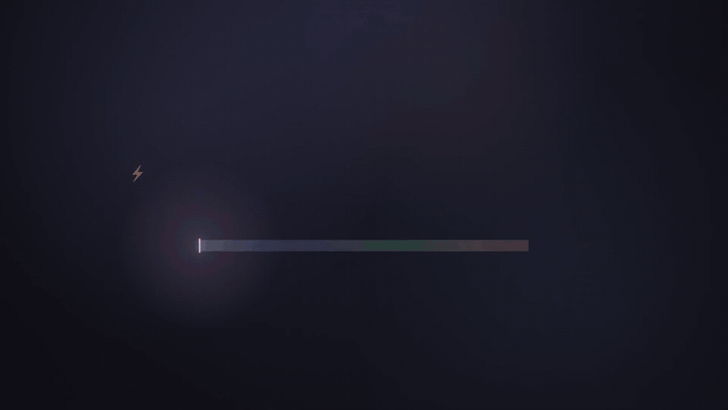
  <br>
  <a href="https://gitreels.com"></a>
  <a href="https://gitreels.com/awesomezun/claude-statusline"></a>
</p>
<!-- gitreels:end -->

