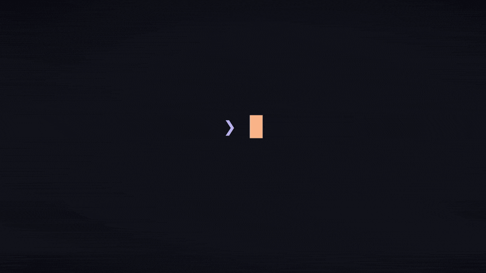

<p align="center">

  <br>
  <a href="https://gitreels.com"></a>
  <a href="https://gitreels.com/awesomezun/claude-statusline"></a>
</p>

<div align="center">


# ⚡ Awesome Statusline

**A beautiful statusline for [Claude Code](https://claude.com/claude-code) — context, usage limits, cost & reasoning `⚡effort`, all at a glance. One line to install on macOS, Linux & Windows.**

[🇰🇷 한국어](README.ko.md) · [Quick Install](#-quick-install) · [Presets](#-five-presets) · [What it shows](#-what-it-shows) · [FAQ](#-faq)


<br/><br/>


<sub>▶ <a href="https://awesomejun.github.io/CC-statusline/">Interactive live demo</a></sub>

</div>

---

## 🆕 What's new

Built to keep pace with Claude Code — recent updates:

| Date | Update |
|------|--------|
| **2026-06-02** | **Windows native renderer** — PowerShell statusline path, no Git Bash or `jq` required on Windows |
| **2026-05-31** | **Opus 4.8** support · reasoning **effort** (`high`/`xhigh`/`max`) + **thinking** indicators · one-line cross-platform installer · 5 size presets (`xs`–`xl`) · JetBrains Mono |
| **2026-04-01** | **1M-token context window** support (Opus) · usage bars render before the first chat |
| **2026-01-19** | Multi-mode display system · plugin marketplace |
| **2026-01-18** | Catppuccin gradient bars · live **5h / 7d** usage-limit monitoring |

---

## Highlights

- ⚡ **Reasoning effort & thinking** — shows `/effort` (`high`/`xhigh`/`max`) and extended thinking, live from Claude Code's official statusline JSON (and hidden on models that don't support effort).
- 📊 **5h / 7d usage** — limit bars from the official rate-limit API, so you can see how much budget is left.
- 🖥️ **No Node, no Nerd Font** — Bash on macOS/Linux, native PowerShell on Windows, standard emoji everywhere.
- 📦 **No Windows extras** — Windows uses built-in PowerShell; macOS/Linux auto-install `jq` if needed.
- 📐 **Five size presets** (`xs`–`xl`) — pick how much you see with one word.

> There are several great Claude Code statuslines out there — this one leans into reasoning-effort/thinking visibility and zero-setup, cross-platform install.

---

## 🚀 Quick Install

You don't need Node. On Windows, you also don't need `jq`, Git, or Git Bash — the installer uses PowerShell.

**macOS / Linux**
```bash
curl -fsSL https://raw.githubusercontent.com/AwesomeJun/CC-statusline/main/install.sh | bash
```

**Windows (PowerShell)**
```powershell
irm https://raw.githubusercontent.com/AwesomeJun/CC-statusline/main/install.ps1 | iex
```

If your security software blocks `irm | iex`, download the installer first, inspect it, then run it:
```powershell
Invoke-WebRequest -Uri https://raw.githubusercontent.com/AwesomeJun/CC-statusline/main/install.ps1 -OutFile .\install.ps1
notepad .\install.ps1
powershell -NoProfile -ExecutionPolicy Bypass -File .\install.ps1
```

To choose a specific size, append it explicitly:
```bash
curl -fsSL https://raw.githubusercontent.com/AwesomeJun/CC-statusline/main/install.sh | bash -s -- xl
```

**Or clone and run**:
```bash
git clone https://github.com/AwesomeJun/CC-statusline.git && cd CC-statusline
./install.sh            # macOS / Linux
./install.ps1           # Windows PowerShell
```

Use any size explicitly — abbreviation **or** full name: `xs`/`xsmall`, `s`/`small`, `m`/`medium`, `l`/`large`, `xl`/`xlarge`.
Then restart Claude Code. That's it.

---

## 📐 Five Presets

One word picks how much you see. Smallest → largest:

| Size | Lines | At a glance |
|------|:-----:|-------------|
| `xsmall` (`xs`) | 2 | model · effort · thinking · path · branch · 3 tiny bars |
| `small` (`s`) | 2 | + labels, percentages, output style |
| `medium` (`m`) | 4 | classic layout, full-width context bar |
| `large` (`l`) | 5 | + cost, session time, 20-block usage bars |
| `xlarge` (`xl`) | 5 | everything: git ahead/behind, env, 40-block bars, resets |

> 🔤 Curious how it looks in *your* font? See the **[12-font showcase →](demo.md)** — 10 cross-platform mono fonts plus Menlo and MesloLGS.

<details>
<summary>📋 Plain-text preview (copy-paste friendly)</summary>
<br/>

Colors render live in your terminal:

```text
xsmall ─ 2 lines
🤖Opus ⚡high 💡 📂~/project 🌿(main)
🧠████░░░░░░ 5H████░░░░░░ 7D██░░░░░░░░

small ─ 2 lines
🤖 Opus 4.8 ⚡high 💡 │ 🎨 default │ 📂 ~/project 🌿(main)
🧠 Context ████░░░░░░ 43% │ 5H ████░░░░░░ 42% │ 7D ██░░░░░░░░ 18%

medium ─ 4 lines
🧠 Opus 4.8 ⚡high 💡 │ 🚧 dirty │ no conda │ 🎨 default
📂 ~/project 🌿(main)
📝 Context █████████████████░░░░░░░░░░░░░░░░░░░░░░░ 43% used
🚀 Usage 5H ████░░░░░░ 42% │ 7D ██░░░░░░░░ 18%

large ─ 5 lines
🤖 Opus 4.8 ⚡high 💡 │ 📝 +5 !12 │ 🐍 venv │ 🎨 default
📂 ~/project 🌿(main) │ 💰 1.23$ │ ⏰ 1h2m
🧠 Context  █████████░░░░░░░░░░░ 43% used (87k/200k)
🚀 Usage 5H ████████░░░░░░░░░░░░ 42% (Reset 2h15m left)
⭐ Usage 7D ████░░░░░░░░░░░░░░░░ 18% (Reset Thu 19:00)

xlarge ─ 5 lines
🤖 Opus 4.8 ⚡high 💡 │ 🎨 default │ 📝 dirty +5 !12 │ 🐍 venv
📂 ~/project 🌿(main) │ 💰 1.23$ │ ⏰ 1h2m
🧠 Context  █████████████████░░░░░░░░░░░░░░░░░░░░░░░ 43% used (87k/200k)
🚀 5H Limit █████████████████░░░░░░░░░░░░░░░░░░░░░░░ 42% (Resets in 2h15m)
🌟 7D Limit ███████░░░░░░░░░░░░░░░░░░░░░░░░░░░░░░░░░ 18% (Resets Dec 31 at 7pm)
```

</details>

---

## 🎨 What it shows

| Element | Meaning |
|---------|---------|
| 🤖 **Model** | Current model (`Opus 4.8`, …) |
| ⚡ **Effort** | Reasoning effort — `low`/`medium`/`high`/`xhigh`/`max`. Live with `/effort`. Hidden if the model has no effort param. |
| 💡 **Thinking** | Extended thinking is on for the session |
| 🎨 **Style** | Active output style |
| 🌿 **Git** | Branch, dirty/clean, ahead ↑ / behind ↓ (xlarge) |
| 🐍 **Env** | Active conda / virtualenv |
| 🧠 **Context** | Context-window usage bar with token count |
| 💰 **Cost / ⏰ Time** | Session cost (USD) and duration |
| 🚀 **5h / 🌟 7d** | Usage-limit bars + reset time (Pro/Max, from the official rate-limit API) |

All colors follow the [Catppuccin](https://catppuccin.com/) palette. No Nerd Font required — every glyph is a standard emoji/Unicode block.

---

## 🔧 Change size or remove

**Change size** — just re-run the installer with a new size:
```bash
./install.sh m          # or: curl … | bash -s -- m
```

**Uninstall** — remove the `statusLine` entry from `~/.claude/settings.json` (a timestamped backup is created on every install) and delete `~/.claude/awesome-statusline.sh` or `~/.claude/awesome-statusline.ps1`.

---

## ✅ Requirements

| Dependency | Why | Installed via |
|-----------|-----|---------------|
| `jq` *(macOS/Linux only)* | parse the Bash statusline JSON | brew / apt / dnf / pacman / zypper / apk |
| PowerShell *(Windows built-in)* | parse and render the Windows statusline | included with Windows |

On Windows, the installer writes a native `awesome-statusline.ps1` and points Claude Code at `powershell -NoProfile ...`. That avoids Git Bash, `.sh` file association issues, and `jq` PATH problems.

---

## 🙋 FAQ

**Does it slow Claude Code down?** No — it's a small local script that runs per refresh.

**I don't see `⚡effort`.** Your current model doesn't expose the effort parameter, so the field is intentionally hidden. Switch to a model that supports `/effort` (e.g. Opus 4.x).

**Why emoji instead of Nerd Font icons?** So it looks right out of the box on any terminal, with zero font setup.

**Where are my old settings?** Every install backs up `settings.json` to `settings.json.backup-<timestamp>` before touching it.

**Statusline is blank, or blank terminal windows keep popping up (Windows)?** Re-run `./install.ps1` — it now installs a native PowerShell renderer and removes the Git Bash / `jq` dependency from the statusline path. Details: [TROUBLESHOOTING.md](TROUBLESHOOTING.md).

**Characters stack vertically inside tmux?** Enable truecolor in `~/.tmux.conf` (`set -ga terminal-overrides ",xterm-256color:RGB"`) and reload tmux. Details: [TROUBLESHOOTING.md](TROUBLESHOOTING.md).

---

## 🧩 Or install via the plugin marketplace

Prefer Claude Code's plugin system? It's also published as a marketplace plugin:

```
/plugin marketplace add AwesomeJun/CC-statusline
/plugin install awesome-statusline
```

Then run `/statusline-setup` to apply it, or pass any size like `/statusline-setup xl`. The one-line `install.sh` above is the primary path; this is just an alternative.

---

<div align="center">

Built with 🩵 for the Claude Code community · [Catppuccin](https://catppuccin.com/) theme · MIT License

⭐ **Star it if it made your terminal nicer.**


<a href="https://www.star-history.com/?repos=AwesomeJun%2FCC-statusline&type=date&legend=top-left">
 <picture>
   <source media="(prefers-color-scheme: dark)" srcset="https://api.star-history.com/chart?repos=AwesomeJun/CC-statusline&type=date&theme=dark&legend=top-left&sealed_token=ntTNhwQ951y6lOVznUbvdeYGCi23yOBbRnadWt5pMTIRfdp6L3KPB1Dwy65vNWI7CIY4R1MzU6yloqyfkwmlEbMoguscV-kFRG5PCqCVyP4_G4XgShBDtg" />
   <source media="(prefers-color-scheme: light)" srcset="https://api.star-history.com/chart?repos=AwesomeJun/CC-statusline&type=date&legend=top-left&sealed_token=ntTNhwQ951y6lOVznUbvdeYGCi23yOBbRnadWt5pMTIRfdp6L3KPB1Dwy65vNWI7CIY4R1MzU6yloqyfkwmlEbMoguscV-kFRG5PCqCVyP4_G4XgShBDtg" />
   
 </picture>
</a>

</div>
